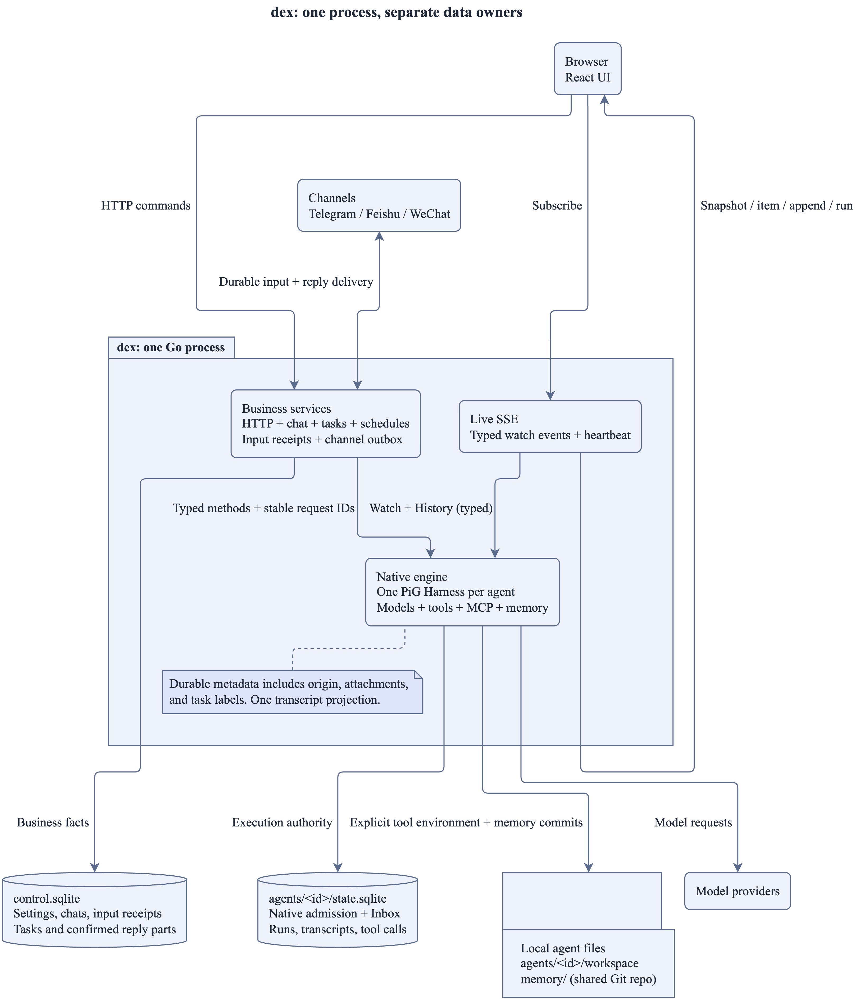
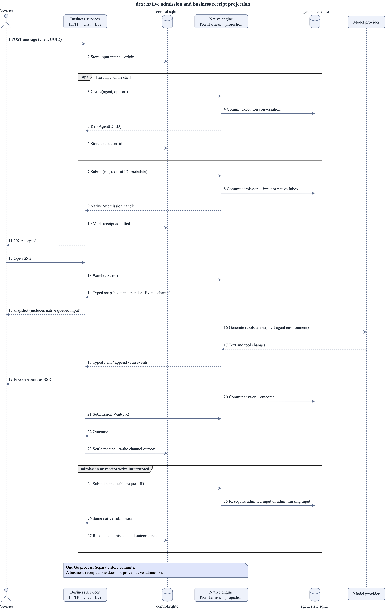

# Architecture

This document is for developers who change dex. It describes the subsystems,
their sources of truth, the message flow, and the failure behavior.

## Runtime overview



Source: [architecture.puml](../../assets/src/architecture.puml).

Control stores messages before delivery. The worker owns agent execution and
storage. The browser receives a transcript through control. Both processes
ship in one binary; they do not share database access.

## Processes

dex is one binary with two processes:

| Process | Code                                              | Responsibilities                                                                 | Does not                              |
| ------- | ------------------------------------------------- | -------------------------------------------------------------------------------- | ------------------------------------- |
| control | Go: `cmd/dex`, `internal/`                        | HTTP API and web UI, chat channels, timers, `control.sqlite`, the worker process | run agents or call models             |
| web UI  | React: `web/`, built into `web/dist` and embedded | chats, live transcript, settings pages, in the browser                           | hold state that the API does not have |
| worker  | TypeScript on Bun: `worker/`                      | one pi-durable Harness per agent, model calls, tool calls                        | know about channels or time           |

`mise run build:worker` compiles the worker with `bun build --compile` into one
executable (about 60 MB, Bun runtime included) and gzips it (about 30 MB) into
`internal/workerbin/dex-worker.gz`. The Go binary embeds that file. At start,
[`worker.Install`](../../internal/worker/install.go) writes it to
`<user cache dir>/dex/worker-<hash>` once, and control starts it as a child
process. See [ADR 0001](decisions/0001-embedded-bun-worker.md).

## Service and updates

`cmd/dex` runs the foreground server or manages a per-user launchd or systemd
service. A host that is not loopback makes the API require the access token
([ADR 0007](decisions/0007-network-access-token.md)). Definitions store serve arguments, PATH, and a
configuration record that permits partial reinstall across template changes.

`internal/update` verifies GitHub release assets, stages beside the executable,
and retains `dex.previous`. The worker owns a two-minute maintenance gate.
It closes admission before checking durable runs and pending memory commits.
Control stores the expiry to restore the gate after a worker restart. New
messages stay stored until release, expiry, or a control restart.
Transcript reads use the gate because opening a Harness can resume stored work.

See [service commands and recovery](../../README.md#run-and-manage-dex) and
[ADR 0006](decisions/0006-service-and-update.md) for lifecycle, update, and gate
decisions.

## Sources of truth

| Data                                 | Owner               | Location                                                                   |
| ------------------------------------ | ------------------- | -------------------------------------------------------------------------- |
| Agents, chats, submissions, settings | control             | `<data dir>/control.sqlite` ([migrations](../../internal/db/migrations/))  |
| Transcripts, runs, tool calls, usage | worker (pi-durable) | `<data dir>/agents/<id>/state.sqlite`                                      |
| Agent files                          | the agent's tools   | `<data dir>/agents/<id>/workspace/`                                        |
| Uploaded files                       | control             | `<data dir>/agents/<id>/workspace/uploads/<upload id>/<name>`              |
| Memory (git repo)                    | the agent's tools   | `<data dir>/memory/`                                                       |
| Skills and MCP servers               | the user's files    | `$HOME/.agents/`, `<data dir>/.agents/`, `<data dir>/agents/<id>/.agents/` |

Control also owns internal delegation records (`tasks`). Each record
has one read-only `task:<execution ID>` session and one input. The worker
owns its transcript and execution records. Control never reads worker SQLite.
The records retain the source submission, status, and report. A cancelled
status records a cancellation request. It does not prove process exit. There
is no user goal lifecycle or automatic retry chain.

Each agent has one main conversation with channel key `main`. The unique
agent/key constraint makes `GET /api/agents/{agentId}/chats/main` safe to repeat.
It creates the control record on demand. Messages use
`POST /api/agents/{agentId}/chats/{id}/messages` and the agent's settings.
The web opens each main conversation at `/a/{agentId}`. `/` redirects to
`/a/default`. `POST /api/agents/{agentId}/chats` takes no body and returns a writable
Chat session (`201`).
Its channel key starts with `chat:`. One SQLite write reuses the newest Chat
with no ordinary message, or creates one. Concurrent opens reuse the same row.
The first message and its title commit together. The title has at most
60 characters. Longer text uses its first 59 characters and an ellipsis. A file-only
message uses the first file's name. Each Chat has its own worker conversation.
It uses the bot's settings, instructions and shared memory. It does not read
main's model context or send its answers to main.

The timeline header opens `/a/{agentId}/sessions`. `GET /api/agents/{agentId}/chats` lists
session summaries
by `updatedAt` descending, then ID descending. `updatedAt` is the latest
conversation creation, input creation or settlement, or task start or end time.
Task times apply only to the task's own conversation. List and detail use the
same rule. The list excludes main, old channel conversations, dreams and
Chat sessions with no message. Task rows add `task: TaskSummary`, without
report bodies. The query does not read reports or transcripts. The page
filters by Chat, Task or Automation. `/tasks` redirects to `/a/default/sessions`.
The active count includes tasks with status queued or running, and other
busy sessions. Each row counts once. A kind filter counts only visible rows.
`New session` appears only on the Sessions page. Other sessions open at
`/a/{agentId}/c/{id}`; tasks open at `/a/{agentId}/tasks/{id}` with Report above
Work. Main stays at `/a/{agentId}`.

Channel input enters the bot's agent main conversation. Chat and
automation contexts stay separate.

Each agent has a page under `/a/{agentId}`. Its tabs are Chat (the base
path), Instructions (`/instructions`), Channels (`/channels`), Automations
(`/automations`), Sessions (`/sessions`), Extensions (`/extensions`), and
Settings (`/agent`). Session and task details use `/c/{id}` and `/tasks/{id}`
under that base path. A layout route keeps the name, tabs, model, and thinking
level in place. The main timelines of visited agents stay mounted and `inert`
when hidden. Their streams, composer drafts, and uploaded attachments survive
agent and tab changes. Browser checks must skip `[inert]` subtrees.
Instructions drafts live in a map by agent ID above the routes. Saving one
agent cannot change another agent's draft or query data. Reload discards drafts.
On a phone the tabs scroll and center the current tab. Channels counts running
channels for the selected agent. Each agent has its own channel controls. Automations counts
enabled automations. Sessions counts active sessions.

The sidebar lists agents in creation order, with default first. Each row shows
an avatar letter, name, status, and an instructions draft pill. The current
agent's row stays selected on all its pages. The status shows active sessions,
else running channels, else Idle. The `+` button opens a create dialog with a
name and the existing model picker. The form starts with the current agent's
provider, model, and thinking level. A successful create opens its empty timeline.
Providers, Secrets, and About are global pages at the bottom of the sidebar.
Old agent page URLs redirect to the same page under `/a/default`.
`/settings` redirects to `/a/default/agent`. An unknown agent shows a not-found
page with a link to Dex. Channel settings show setup and runtime status.
Automation details keep their run history. Automation transcripts have no
web composer.

Every enqueue writes `submissions.origin`. Web input in main and Chat uses `web`.
Channel input uses the exact peer, such as `telegram:7`, and always enters main.
Automation, task input, and dream input use `automation`, `task`, and `dream`.
A task result copies its source submission's origin in the same transaction
that saves the report and inserts the result. A result chain thus keeps the
first input's origin. Existing rows use `unknown`. The durable channel sender
routes ordinary replies and task results by origin. Web input sends no channel reply.
The live hub adds origin to user items in queued input, snapshots, live events
and history pages. The web shows the channel name beside each channel input.
The worker protocol has no channel fields.

The default data directory is `~/.dex` (`DEX_DATA_DIR`). pi-durable allows one
process per storage, so only the worker opens an agent directory.

## Agents and HTTP API

One owner can create several agents. `GET /api/agents` returns
`{agents: [Agent]}` in creation order. Each list entry has `activity` with
`activeSessions`, `runningChannels`, and `enabledAutomations`. One SQL query
counts sessions and automations across all agents. A task counts when queued or
running; other visible sessions count when they have pending input. Each session
counts once. Channel counts come from the app registry. The sidebar polls this
list every three seconds and shares its cache with agent tabs. `POST /api/agents` accepts a name,
provider, model ID, thinking level, and optional instructions. It returns the
agent with a UUID v7 ID (`201`). The ID is read-only. `GET` and `PUT` on
`/api/agents/{agentId}` read and save one agent. Names and models use the same
validation for creation and updates.

Agent resources are under `/api/agents/{agentId}`: main, chats and their
settings, messages, clear, history, abort and events; task details; uploads;
extensions and reload; automations and their run and runs endpoints. An unknown
agent or a resource owned by another agent returns `404`. Upload storage uses
`<data dir>/agents/<agentId>/`. Control builds the path store for each request.
Each live stream carries its agent ID for worker watches and history. Worker
conversation IDs can be equal in different agents.

Session, health, maintenance, models, provider settings, and
`/api/automations/preview` stay global. One settings service and lock own
settings changes. Creating or selecting an agent does not configure providers.
One scheduler job checks automations across all agents and posts each prompt
with the saved agent ID. Extension reload restarts the whole worker and affects
every agent.

The web UI uses the nested agent routes, including live events and upload
links. Agent resources require an explicit ID, including the default agent.
The old un-nested API routes return 404. `GET /api/settings` returns only global
settings and has no agent or channel fields. Channel setup and status use
`/api/agents/{agentId}/channels`, with `/telegram`, `/wechat`, and `/feishu`
for changes. The old `/api/settings/{platform}` routes return 404.

## Memory

The memory is a git repo in the
[Agent Memory Repo](https://github.com/AgentMemoryRepo/agentmemoryrepo) format
at `<data dir>/memory/`. It belongs to the user, so all agents and channels
share it. See [ADR 0004](decisions/0004-agent-memory-repo.md).

- **Read.** The [`memory` extension](../../worker/src/memory.ts) adds three
  system prompt sections: the memory rules (the repo path, the entry format,
  and the chat's `source`), shared `MEMORY.md`, and that agent's
  `agents/<agentId>/MEMORY.md`. Other agents do not load this last section.
  They render before each model
  request, so a change applies from the next request, also inside a run.
  pi-durable sends a section again only when its text changed. The agent
  finds the other files with grep and the `[[path]]` links.
- **Write.** The agent changes the files with its edit and write tools,
  without approval. It does not run git. When a submission settles, the
  worker commits all changes as `Update memory from <source>`. The source is
  `dex:<agentId>/chat/<chatId>`, or `dex:<agentId>/dream/<dreamId>`.
  Old `dex:chat/<id>` sources remain valid and mean the default agent.
  Owner facts go in shared `MEMORY.md` and its topic files. Role experience
  and ways of working go in `agents/<agentId>/`, with its own `MEMORY.md`
  entry point. This keeps one bot's habits out of the owner's preferences.
- **Dream.** The [scheduler](../../internal/scheduler/scheduler.go), a
  wrapper of gocron, runs [`dream.Dreamer`](../../internal/dream/dream.go)
  at start and then every hour. The schedule only causes a check; the
  `dreams` table decides. One Dreamer checks every agent. When an agent has a
  model, none of that agent's submissions are pending, no dream is pending
  across all agents,
  the last dream started 24 h ago or more, and the oldest settled message that
  no dream read is 24 h old or more, the check starts a dream. A dream is a
  hidden chat (channel key `dream:<id>`). Its system prompt holds the dream
  instructions and the privacy and language parts of the agent instructions.
  Its message holds the new messages as JSON lines, in settle order, with
  local times: up to 500 messages or 100,000 bytes. A text longer than 4,000
  characters keeps its first 3,000 and last 1,000 characters and is marked as
  cut. The agent adds what repeats across its chats. It tidies its own folder
  and shared entries whose chat sources all belong to it. Entries with other
  agents' sources, including mixed sources, can only gain `uncertain: yes`.
  Shared entries with no chat source stay unchanged. The
  `dreams` table records the last message that each dream read; the next dream
  starts after that agent's newest done dream.

## Extensions

Skills, MCP servers, and `.env` come from three levels: home (`$HOME/.agents/`),
dex (`<resolved data dir>/.agents/`), and agent (`<data dir>/agents/<id>/.agents/`).
Narrower levels win. Paths are fixed before `.env` is read. Equal real paths
are read once as the narrower level. See [ADR 0010](decisions/0010-extension-levels.md).
Each agent has its own environment snapshot for tools and stdio MCP servers.
Invalid `.env` or MCP files prevent all MCP startup for that agent. Invalid
`.env` also removes all file environment values from that snapshot.
[`AgentExtensions`](../../worker/src/extensions.ts) connects the servers when
the worker opens the agent, before `resume()`. It installs one pi-durable
extension: a `skills` prompt section, which reads the skill files before each
model request, and the MCP tools, as deferred tools named
`mcp__<server>__<tool>`. When an agent has MCP tools, the worker also installs
`tool_search`.

`GET /api/agents/{agentId}/extensions` reads the files. Before the agent opens,
the servers are `idle`. `POST /api/agents/{agentId}/extensions/reload` takes the
maintenance lease, which it refuses when another holder has it. It validates
the files of every open agent and the requested agent. If any
configuration is invalid, it refuses with the agent name and error. It restarts the
whole worker, opens the agent, and releases the lease. The restart affects every
agent.

The task extension adds delegation tools and a `task-rules` section to
foreground conversations, including main, Chat and automation sessions.
Background executions and dreams have no delegation tools. A separate
extension gives foreground conversations and background executions the `coding-skill`
section. Bun embeds the full
[built-in coding skill](../../worker/skills/coding/SKILL.md) in the worker.
It does not copy the skill into a user directory or add a new extension scope.
The skill requires a repository path, project rules, independent review, tests
of the final revision, and evidence in the report. It requires serial writes
or separate worktrees for tasks that change the same repository.

## Automations

An automation runs a prompt on a schedule; see
[ADR 0005](decisions/0005-automations.md).
[`automation.Service`](../../internal/automation/automation.go) stores
automations and their runs in `control.sqlite`. One scheduler job calls its
`Check` every minute for all agents. Each row supplies its owning agent ID.
`Check` posts the prompt of each automation whose
`next_due_at` has come, as a message to its chat (`automation:<id>`, or
`automation:<id>:<run id>` for a new chat each run), and moves `next_due_at`
past now. The message uses the normal durable delivery.

## Settings

The web UI edits all settings; see [ADR 0002](decisions/0002-settings-in-control-db.md).
[`settings.Service`](../../internal/settings/settings.go) validates a change,
saves it in `control.sqlite`, and then applies it:

| Setting                                 | Table               | Applied by                                                   |
| --------------------------------------- | ------------------- | ------------------------------------------------------------ |
| Bot model, thinking level, instructions | `agents`            | the next `submit` of each chat                               |
| Chat model, chat thinking level         | `conversations`     | the next `submit` of that chat                               |
| Providers                               | `providers`         | `configure` to the worker, and again after each worker start |
| Telegram token, allowed users           | `telegram_settings` | a restart of the bot                                         |

`PUT /api/agents/{agentId}` saves the name with the other bot settings.
The API trims spaces, then accepts 1 to 40 Unicode characters. The web uses the saved name in
the sidebar, the timeline header, and the composer.

Main and Chat sessions use the agent's model and thinking level. They have no
session override. `chat.Service` resolves settings at each `submit`. Channel chats cannot
change their settings (403). An automation chat can; an automation that
reuses its chat then runs with the chat's settings. The thinking levels and
the `reasoning` and `input` of a model come from pi-ai
(`getSupportedThinkingLevels`); pi-ai sends the nearest level that the model
supports, and `off` to a model without reasoning.

The user adds any number of providers, and then chooses one model from all of
their models. A provider is one of:

- **Built-in**: a pi-ai provider (Anthropic, OpenAI, OpenRouter, and more) with
  an API key.
- **Custom**: an ID, a base URL, an optional API key, and one of the APIs
  `openai-completions`, `openai-responses`, or `anthropic-messages`. Its
  models are the listed model IDs, or else the ones that the endpoint's
  `/models` (OpenAI) or `/v1/models` (Anthropic) returns. A custom provider
  without a key sends the key `none`, for local servers.

For task tools, custom `openai-responses` providers send `strict:false`.
This keeps optional parameters optional at Responses endpoints.

The worker keeps the providers only in memory (built-in keys in pi-ai's
`InMemoryCredentialStore`) and gets no provider environment variables. When a
custom provider's model list fails, the provider stays saved and the API
returns the reason. When a change is saved but the
worker cannot apply it, the API returns an error; the next worker start
applies it. The agent has no model until the user chooses one; a message
before that is `unanswered`.

## Worker protocol

Control writes one JSON request per line to the worker's stdin. The worker
writes one JSON response or event per line to its stdout. Logs go to stderr.
The types are in [`worker/src/protocol.ts`](../../worker/src/protocol.ts) and
[`internal/worker/protocol.go`](../../internal/worker/protocol.go).

| Method               | Params                                                                                                                 | Result                    |
| -------------------- | ---------------------------------------------------------------------------------------------------------------------- | ------------------------- |
| `ping`               | none                                                                                                                   | `{}`                      |
| `createConversation` | `agentId`, `model`, `thinkingLevel`, `instructions`                                                                    | `conversationId`          |
| `submit`             | `agentId`, `conversationId`, `model`, `thinkingLevel`, `instructions`, `requestId`, `content`, `attachments`, `source` | `submissionId`            |
| `configure`          | `providers`: `id`, `name`, `api`, `baseUrl`, `apiKey`, `models`                                                        | `errors` per provider     |
| `listProviders`      | none                                                                                                                   | built-in `providers`      |
| `listModels`         | none                                                                                                                   | `models` with credentials |
| `watch`              | `watchId`, `agentId`, `conversationId`                                                                                 | `{}` after the snapshot   |
| `unwatch`            | `watchId`                                                                                                              | `{}`                      |
| `abort`              | `agentId`, `conversationId`                                                                                            | `{}`                      |
| `checkIdle`          | `agentId`, `conversationId`                                                                                            | `{}` or busy              |
| `reset`              | `agentId`, `conversationId`, `requestId`                                                                               | `submissionId`            |
| `history`            | `agentId`, `conversationId`, `before`, `limit`                                                                         | `items`, `nextBefore`     |
| `inputEntries`       | `agentId`, `conversationId`, `requestIds`                                                                              | request ID to entry ID    |
| `extensions`         | `agentId`                                                                                                              | the Extensions schema     |

The worker can also send a `task` request to control. Its params contain the
agent, worker conversation, durable tool key, source request ID, action, and
arguments. Control returns a response with the same ID. IDs in the two pipe
directions have separate namespaces. Control handles these requests outside
the stdout reader because a task action can call the worker for validation.

`submit` also accepts `whenBusy`, `taskStageId`, and a trusted input kind.
Task result delivery uses
`whenBusy: reject`, so it remains in control while the source session has an active
run or queued inputs. `abort` requests SDK cancellation with a 5 s wait limit.
The SDK saves the cancellation before it waits for idle. An SDK error or timeout
returns an RPC error. The wait limit excludes admission and conversation
serialization. `recoverTasks` registers started task conversations before the
worker opens any Harness.

The worker runs submits and aborts for one conversation in order. When `model`,
`thinkingLevel` or `instructions` differ from the conversation's, it changes
the conversation first; a run in progress keeps its settings until its next
turn.

Event `settled`: `requestId`, `status` (`done` or `unanswered`), `answer` or
`reason`. The worker sends it when a submission has its final answer.

Event `chat`: `watchId` and `events`, the chat events of one commit, or `end`
when the watch stopped. The first event of a watch is a snapshot. The worker
places each message as an entry of kind `dex.user` with control's submission
ID, so the user item in the transcript has the ID that the browser sent.

## Message flow



Source: [message-flow.puml](../../assets/src/message-flow.puml)

1. The browser opens `GET /api/agents/{agentId}/chats/main`, then sends
   `POST /api/agents/{agentId}/chats/{id}/messages` with a UUID that it makes.
   [`chat.Service.Send`](../../internal/chat/chat.go) refuses the message when
   neither the chat nor the agent has a model. Otherwise it finds or creates
   the conversation for
   the channel key (`main` or `chat:<id>` for web input), stores the message as a
   `pending` submission with that UUID as its ID, and returns `202`. A
   retried request with the same UUID stores nothing.
2. `chat.Service.Run` delivers stored submissions in SQLite insertion order
   (`submissions.rowid`), including after restart and replay. Timestamps are
   for display and do not control delivery. An input that needs another delivery
   attempt blocks later inputs of its chat. Other chats can still receive input.
   On the first
   message of a chat, it calls `createConversation` and stores the worker's
   conversation ID.
3. Control calls `submit` with the submission ID as `requestId`. pi-durable
   commits the input before it answers.
4. The worker runs the model and the tools. The browser sees the run through
   the chat's event stream (next section).
5. The worker sends `settled`. Control marks the submission `done` or
   `unanswered`, and the channel sender reads the answer from durable storage.

## Internal delegation

The main agent uses `spawn_task`, `list_tasks`, `get_task`, and `cancel_task`.
Each spawn creates one execution with fixed model and thinking settings.
There is no goal acceptance lifecycle. The main agent checks saved records
before it reports progress or starts another execution. The main agent owns
implementation, independent review, fixes, final tests, and the user report.
Background conversations cannot call delegation management tools. Control
checks this boundary as well as the worker's tool list.

Creation checks source ownership, pending input, deduplication, and capacity
in one SQLite write transaction. The durable spawn key is the agent ID plus
pi-durable's tool task ID. Replay returns the same execution. Each agent admits
at most 2 queued or running executions. Cancellation releases admission, so a
tool that ignores cancellation can continue after another execution starts.
The main agent handles failure, retry, and continuation from saved artifacts.
The prompt requires a record check before progress reports or follow-up work.

Normal completion (`done`) and execution failure (`failed`) create a durable
`task_result` submission in the same transaction as settlement. The result
waits in control while the source chat is busy. Stop and directed cancellation
set active executions to `cancelled`. Worker loss sets running executions to
`interrupted`. These states create no result turn. A terminal record and its
saved report stay unchanged when a late worker event arrives.

Control passes a trusted submission kind to the worker. The worker stores
internal results as a separate entry kind. The public transcript replaces
that input with a `task` mark that contains no report text. `live.Hub` uses
the mark's submission ID and chat to read the work's title from control.
The web groups output after that mark until the next user or task item.
A failed result reply cannot retry the user message before the mark.
Control's pending user projection selects only `kind='message'`.
Neither layer uses message text or an ID pattern to hide results. Ordinary
user JSON still appears and can use the normal Retry action. Task conversations
appear in Sessions but stay absent from dream inputs. The human can read their chat,
history, and normal SSE stream. Web input, settings, clear, and abort are refused.
Dream input selects only ordinary messages, so internal results in a source session
cannot enter memory as user text.
`GET /api/agents/{agentId}/tasks/{id}` returns one record with its report, times, and conversation
ID. The task and session reads check the agent. Model task tools keep their
parent conversation scope. There is no `GET /api/agents/{agentId}/tasks` list, HTTP task control,
or separate task stream. The Sessions page and each writable session poll
session summaries every 3 s.
Task details poll every 3 s while queued or running. Terminal details stop polling.
Task details use the normal read-only chat, history, and SSE paths for Work.
Successful `spawn_task` items carry the ID from the saved tool result. Result
marks carry the ID and title from control's matching task record. The web links
both labels by ID. It never matches tasks by title.
The source session's normal SSE stream carries result marks and replies.
A task started in Chat keeps that Chat as its parent. Its result returns to
that Chat, with the source input's origin. Main does not receive the result.

Result delivery uses the existing submission lifecycle. A provider failure
leaves the result unanswered. Control never changes a settled submission back
to pending, so no retry counter or delivery recovery state is needed. The
main agent can read the saved report and choose the next action. A user Stop
withdraws pending results. A later greeting cannot revive those results.
A new execution must check prior artifacts and side effects.

Web Stop covers only the selected writable session, main or Chat. Task,
old channel and automation sessions are read-only on the web. Messages, Clear
and Stop return 403 for those kinds.
Channel `/stop` calls main Stop. It covers main input from every entry and
tasks started in main. Chat, automation and other agents stay outside that scope.
Channel `/new` calls main Clear with the same busy check and reset ordering.
It does not cancel background work. The result keeps the work's original peer.
Stop withdraws pending ordinary input and results. The same transaction sets
active background executions to `cancelled` and withdraws their own input.
Stop and spawn acquire the SQLite writer before they read: spawn either commits
first and is cancelled, or fails because its source is no longer pending.
Submission and Stop share a delivery lock, so cancellation cannot pass an
input that control still intends to submit. Stop then requests cancellation
once for each worker conversation through the bound current process. Each RPC
has a 6 s timeout. RPC failure is logged; saved cancellation stays in effect.
There is no cancellation retry loop. Late reports cannot change a terminal
record or wake the model.

`POST /api/agents/{agentId}/chats/{chatId}/abort` returns `{status: "ok"}` after withdrawal and the
cancellation requests. The composer keeps Stop available for queued input,
an active answer, and active background work started by that conversation.
Tasks from other conversations count in the bot's badge but cannot enable
that session's Stop. Task summaries expose `parentConversationId` for this check.
Stop needs no model. During a
reconnect, the chat API's busy state keeps Stop available before the snapshot.
The reply confirms the request. It does not prove process exit. Processes and
remote work can continue. Cancellation does not undo file writes or remote
actions. A directed cancellation of a completed execution leaves its report
and saved result unchanged.

Control binds admission to the current worker process. It joins old worker
callbacks before it starts the next process. After worker loss, a running
execution becomes `interrupted`. It does not run again or create a result turn.
Before Harness resume, the worker isolates all started task conversations,
including cancelled executions whose cancellation request could not reach the
old worker. Queued execution that never started can start for the first time.
Completed results already saved for delivery retain their submission state.
Durable spawn replay returns the original record.

The SDK owns cancellation of run invocations and tools. Control does not track
process trees or confirm exit. A normal local or MCP tool return can settle
execution. An aborted MCP call ends the local wait and requests remote
cancellation. It does not prove that the remote job stopped. Before another
execution, the main agent must check reports, artifacts, and prior actions.

Tools use the local `NodeExecutionEnv`, without a sandbox. CLI tools must be
logged in and run in the foreground with non-interactive options. Detached
processes and daemons are outside the supported lifecycle. Bash has no default
timeout. Its visible output keeps at most the last 2000 lines or 50 KiB,
whichever limit comes first; complete output goes to a temporary file.
A durable checkpoint does not attach a CLI after restart or guarantee that
external actions occurred once.

## Attachments

1. The browser sends each file as `POST /api/agents/{agentId}/uploads` (multipart, one file,
   at most 20 MB). [`upload.Store`](../../internal/upload/upload.go) writes
   it to `workspace/uploads/<UUIDv7>/<name>` and returns its ID, name, size,
   type (from the content) and workspace path. The directory is the only
   record of an upload.
2. A message carries at most 10 upload IDs. Control checks each ID and stores
   the attachments as JSON with the submission, so a replay sends the same
   list.
3. The worker gives the model the text and then `Attached files:` with one
   workspace path per line. The model reads a file with the read tool, which
   also prepares images for a model with image input. The `dex.user` entry
   keeps the attachments, so the transcript shows the files and the text
   without the list.
4. `GET /api/agents/{agentId}/uploads/{id}` serves a file for the transcript.

The contract is [`api/openapi.yaml`](../../api/openapi.yaml): schemas `Item`
and `ChatEvent`. See [ADR 0003](decisions/0003-web-ui-stack-and-live-transcript.md).

```
browser ──EventSource──▶ control  GET /api/agents/{agentId}/chats/{id}/events
                           │ watch / unwatch, one watch ID per stream
                           ▼
                         worker  watchEvents() and ChatView (worker/src/view.ts)
                           │ event chat {watchId, events}
                           ▼
                         control (internal/live) adds control's messages and writes SSE
```

- [`ChatView`](../../worker/src/view.ts) keeps the raw pi-durable state,
  renders all items from it, and diffs the new items against the old ones. It
  sends `append` when only text was added, `item` for any other change, and a
  `snapshot` when an item was removed or pi-durable sent a snapshot.
- Each stream has its own worker watch, so each browser tab gets its own
  snapshot. The first event of a stream is a snapshot, so a reconnect needs no
  replay. This snapshot includes control changes made while watch waited.
- [`live.Hub`](../../internal/live/live.go) adds the messages that only
  `control.sqlite` has: a `pending` message that the worker has not placed yet
  (a queued user item), and an `unanswered` message that the worker never
  placed (a user item and an error item). It also adds the task ID and title to
  each task mark from the matching result submission. The hub places unanswered
  messages before the next newer user or task item. It then appends queued messages in
  receipt order, after all current worker output. The browser inserts new output
  before those queued messages until the worker places them. History merging keeps
  each control-only input with its error, before the next newer input or reset.
- The worker's reader never waits for a stream. A stream that is 256 inputs
  behind is closed, and the browser reconnects.
- A stream sends a comment line every 15 s.

`POST /api/agents/{agentId}/chats/{id}/clear` uses the delivery lock and a SQLite writer
transaction to check pending input and insert `context_reset` together. The
worker also checks its active run and inbox. A refused request stores nothing.
Delivery uses `submit({type: "write", requestId, entry: {kind: "pi.reset",
head: "self"}})`. pi-durable 1.2.0 deduplicates the request ID before writing.
`Conversation.reset()` does not pass a request ID. A crash replay thus uses
the write form and adds no second reset. Reset entries keep their time in data.
Memory files remain available. Follow-ups keep the SDK default: one input
per answer. Do not use `followUpMode: "all"` or steer.

The Clear context action is in the composer. The server alone decides whether
work is active. A 409 shows a warning and keeps the same request ID for a retry.
The action is hidden when the last non-compaction item is a reset or is absent.

A snapshot contains only the active worker context. Reset entries show dividers.
Compaction entries stay in the data but have no divider. `historyBefore` points
to the head entry. The browser requests
`GET /api/agents/{agentId}/chats/{id}/history?before=<entry ID>&limit=100` on demand. The worker
reads `Conversation.entries` before that exclusive cursor and returns items
in entry order with `nextBefore`. A page can extend to the previous assistant
or input so a tool call keeps its result. Committed assistant block IDs use
`e<entry ID>:<block index>`. User IDs remain submission IDs; tool IDs remain
call IDs. The browser merges overlaps by ID and keeps queued input last.
The hub checks retired failed inputs through `inputEntries`, so a snapshot
does not restore the same failure with a second ID. History loads those entries.

## Telegram

[`telegram.Bot`](../../internal/telegram/telegram.go) is on when the settings
have a bot token. It reads messages with `getUpdates` long polling,
so dex needs no public URL.

- Only private chats can enter the agent. The bot ignores users outside the
  saved allowlist. A saved token with no allowed users waits for owner pairing.
  Earlier versions accepted group messages from allowed users. The bot now
  ignores all non-private chats, including messages from allowed users.
- The Telegram channel page creates a link with the bot username from `getMe` and a
  random code. The code expires after 10 minutes. `telegram_settings` stores
  the code and expiry. Pairing is available only while the allowlist is empty. One atomic SQLite
  update sets the owner as the only allowed user and clears the code.
  Invalid or expired codes create no user or chat. A new link or settings
  change cancels the previous code. Manual user-ID entry remains available.
  An allowed user who repeats a pairing command receives an already-paired
  reply, including after a lost acknowledgement or restart.
- The bot registers `/new`, `/stop`, and `/help`
  with `setMyCommands`.
  The channel manager owns command execution and deduplication.
- Each update has a stable source key: `telegram:<bot id>:<update id>`.
  A repeated update does not create another submission.
- Goldmark parses Markdown into Telegram HTML. The sender splits at block
  boundaries and closes code tags in each part. Each part has at most 4096
  UTF-16 code units, including markup. A rejected HTML part retries as plain
  text. The shared durable sender retries final-send failures, including 429,
  with a delay from 5 to 60 seconds. Markup and escaped characters count
  toward the current splitter limit. This can produce more parts than
  Telegram requires. Keep these boundaries stable for stored delivery progress.
- Each pending submission has a worker watch through `live.Hub`. The bot
  updates a private draft at most once per second. If drafts fail, the bot
  sends one preview and edits it. Typing refreshes every 4 seconds. Previews
  are best effort. Queued user items do not start answer segments. The final
  reply stops and joins its preview before delivery. Preview registration and
  final lookup use one lock; attachment downloads do not hold this lock.
- Photos use the largest size. Documents and photos pass through
  `upload.Store`, with a 20 MB limit. Captions become message text. The agent
  and web transcript use the same upload record.
- Polling checks the token through `getUpdates`. A transient startup failure
  does not stop the bot. Poll errors and recovery update runtime status in
  bot settings. Tokens do not appear in status reasons.
- Pairing and attachment-rejection replies skip permanent 400/403 failures
  so later updates can proceed. Transient failures leave the update for retry.

## Shared channels

The app owns a registry with one Manager per agent. Startup restores all agents' bots.
Creating an agent adds its Manager. Shutdown stops all Managers before the database closes.
Uploads and live previews use the bot's agent directory and stream. Chat notifications
wake all Managers; each Manager reads only its agent's replies and commands. This fan-out
is a limit: route notifications by agent if wakeups become costly.

Channel settings use `agent_id` as their primary key. Telegram tokens, WeChat bot IDs,
and Feishu app IDs are unique across agents. A duplicate returns 409 and names the
agent that owns the credential. QR login and registration sessions are also per agent.
Migration maps old settings, peers, and commands to `default`. Rollback keeps only
that agent's channel data. WeChat runtime remains keyed by bot ID and owner.

[`channel.Manager`](../../internal/channel/channel.go) owns bot lifetime,
commands, and reply delivery. Settings changes stop the old bot
before they start its replacement. Settings expose runtime status: `off`,
`running`, `error` with a reason, or `needs_login`.

A peer names a remote destination, such as `telegram:7`. Owner input from all
channels enters the bot's agent `main` conversation with that peer as origin.
Channel input cannot select a Chat session. Old `channel_peers` records and
per-peer conversations remain stored but receive no new channel input. The
Sessions list excludes those conversations. Main and Chat are writable on
the web. Automation transcripts have no web composer.

`/new`, `/stop`, and `/help` use durable command
receipts. `/new` uses `channel:<source key>` as its stable reset request ID.
A crash after reset admission but before command completion reuses that reset.
A busy refusal is saved in the command receipt; replay cannot clear it later.
The command sends one short notice. Reset submissions have no model reply.
An incomplete command with an old peer channel key gets a notice with no action.
`/stop` records stop intent for main and
withdraws queued input and pending results. A channel Stop saves its answer
in the same transaction as the withdrawal. If command completion fails,
replay uses that answer without another withdrawal or worker abort. The reply
confirms the cancellation request and states that processes and remote
work can continue. A stop error does not block later messages or other replies.

Each platform has one durable sender. Settlement wakes the origin's sender.
Main Stop wakes all senders for withdrawn input. At start
and after a failed send, it reads settled submissions and command replies
that remain undelivered, in submission admission order. It records each confirmed part and marks the reply
delivered after its last part. A permanent rejection skips that part and does
not block later replies. A transient error retries with a delay from 5 s to
60 s. Each bot receives a stable delivery ID and part index through `Bot.Send`.
Worker replay still reads only pending submissions.
Delivery is at least once: a crash between platform success and the local
commit can duplicate one part. Migration marks old settled replies as delivered
because earlier versions did not record delivery success.

See [ADR 0009](decisions/0009-channel-layer.md).

## Feishu and Lark

[`feishu.Bot`](../../internal/feishu/bot.go) receives private messages through
one WebSocket long connection. It needs no public callback URL. The REST
client caches the tenant token and refreshes an expired token. The transport
uses `coder/websocket` and a small protobuf Frame encoder and decoder. It
handles ping, pong, fragmented events, acknowledgement, and reconnect hints.
Startup failures report an error and retry with the REST backoff, up to
2 seconds between attempts. A configured bot retries until cancellation,
even if the server sends a finite `ReconnectCount`. After a disconnect, the
first reconnect waits only for the server's jitter. Later failures use the
server's reconnect interval. A socket with no data for two ping intervals
reconnects. A pong that changes the ping interval also resets the next ping.
The ping timer and read deadline use the same interval.
Fragment buffers expire after 5 seconds. One connection allows at most 64
fragmented events, 256 fragments per event, and 4 MB per event.

The Feishu channel page shows runtime status and supports QR app creation and
manual credentials. The form keeps the saved Feishu or Lark brand unless the
user changes it. QR setup requests `im:message`, `im:message.p2p_msg:readonly`, `im:resource`, and the
`im.message.receive_v1` event. The server keeps the device code in a session
until approval or expiry. Registration requests release the settings lock
while they wait for the accounts service. Cancellation or replacement rejects
late responses. Lark tenants use the Lark accounts service. Setup
saves the creator's `open_id` with the app credentials through
`settings.Service`. Manual setup requires a one-time code sent in a private
message. The code expires after 10 minutes. A credential change clears owner
authorization. The settings API never returns the saved app secret.

The bot ignores groups and other users. Text mentions are removed. Rich posts
become text and image attachments. Code blocks keep their text and language
in Markdown fences. Repeated `/pair` messages never reach the agent.
Message resources pass through `upload.Store`, with its 20 MB file limit and 10 attachments per message.
The shared channel manager handles `/new`, `/stop`, and `/help`. A source key contains `feishu:<app ID>:<message ID>`. The bot acknowledges valid agent
input after durable admission succeeds. Invalid content, rejected resource access,
and files with invalid names or excessive size are acknowledged and ignored.
Storage and temporary platform failures get a 500 acknowledgement for retry.

A preview card reads the chat's worker watch events. It merges text updates
at 250 ms intervals and omits thinking and tool data. The shared durable
sender patches that card with the final answer, or creates a final card when
no preview exists. It uses the submission ID and part index for stable send
UUIDs. Each text part is at most 4000 UTF-8 bytes. A card rejected with HTTP
400 or an HTTP success status and code `230001` falls back to plain text.
Temporary or uncertain send
failures keep the card format and stable identity for retry. An uncertain final
patch keeps the preview ID, so durable delivery retries the same card. A successful
final patch restores `running` status.
Network failures, server errors and rate limits get at most
3 attempts per token. JSON calls and downloads share authorization and one
token refresh. A token rejection can therefore cause up to 6 API attempts,
plus token requests. Downloads wait at most 30 seconds for response headers;
each complete download has a 5-minute deadline, including error body reads.
Downloads use the socket session context.
Durable admission uses the bot lifetime, so a disconnect cannot cancel a stored
message while it waits for queue space. JSON responses remain
bounded to 4 MB and download error responses to 1 MB. Retry delays are
200 ms and 800 ms; `Retry-After`
can extend a delay to at most 2 seconds. Reply delivery remains at least once.
Previews use the bot lifetime and continue across WebSocket reconnects.
Previews are best effort and do not mark a reply as delivered. A restart can
leave a preview card in the platform; the durable sender sends a final card.

The standard `mise run check` task includes local platform tests and worker
E2E tests for Feishu. These tests make no real platform requests.

## WeChat

[`wechat.Bot`](../../internal/wechat/bot.go) connects one iLink bot to its
owner's private messages. The WeChat channel page starts QR login and polls each
state. It asks for a phone verification code when required. A region redirect
changes the poll host. An expired or blocked QR code gets a replacement, with
at most three replacements per login attempt. The backend queries QR status only
when the page requests a poll. Closing the page stops new polls; an in-flight
request ends within 35 s. There is no fixed deadline for the whole login attempt.

Only a confirmed result with a bot token, bot ID, base URL, and owner ID can
activate the bot. Invalid confirmation stays failed on later polls. Valid
candidate credentials remain available if local activation fails. Activation
stops and joins the old bot before it changes shared runtime state. It saves
credentials and runtime initialization in one transaction, starts the replacement,
and then reports `confirmed`. If the transaction fails, it restores the previous
bot. A new login ID or delete invalidates an older login request.

The bot ignores other senders, group messages, bot echoes, and unfinished
messages. It stores the owner's latest context token before it admits a
submission. Each source key uses the bot ID and message ID. The bot advances
the durable update cursor only after every message in the batch is stored or
explicitly rejected. A repeated batch therefore cannot run a submission twice.
Cursor, context token, and pause time are runtime state in `control.sqlite`.
The settings API does not return them. Login initializes the runtime row; bot
reads use SELECT. A missing row is a storage invariant error and retries with
an error status.

Message IDs retain the full protocol `uint64` range. Context watermarks use
20-digit decimal TEXT so SQLite can compare them without signed truncation.
The context guard retains the existing assumption that larger message IDs are
newer. The [official Tencent client 2.4.10](https://registry.npmjs.org/@tencent-weixin/openclaw-weixin/-/openclaw-weixin-2.4.10.tgz)
declares `uint64` IDs but provides no
numeric chronology guarantee in its protocol types or receive loop. This
assumption remains unverified; no new ordering mechanism is introduced.

Text and voice transcription become message text. Quoted text gets a
`[引用: ...]` prefix. A video becomes a placeholder. Images and files pass
through CDN download and AES-128-ECB decryption into `upload.Store`, with the
same limits as web uploads: 10 files per message and 20 MB per file. Invalid
media is rejected. CDN HTTP 408 and 429 are temporary failures. A temporary
download or storage error keeps the batch cursor unchanged. Existing submission
and command receipts are checked before attachment downloads. An interrupted
command still completes through the shared manager. A failed or rejected attempt
removes its new uploads before admission. Admitted submissions keep their files.

While a submission is pending, the bot sends typing status every 5 s. Final
answers keep supported Markdown and use parts of at most 2000 characters.
Unanswered submissions send a short error message. The durable sender reads
the saved context token before each send, including after a restart.

## Failure behavior

- **Worker exits.** [`worker.Worker.Run`](../../internal/worker/worker.go)
  restarts it with a backoff from 1 s to 30 s. Calls wait for the new process.
  After each start, control isolates old task conversations before any Harness
  resumes. Started execution lost with the worker becomes interrupted and does not
  restart automatically. `chat.Service.Replay`
  re-admits pending ordinary messages and eligible normal results with
  their stable request IDs. pi-durable deduplicates input admission. This does not guarantee that
  an external tool action occurs once.
- **Control exits.** Pending submissions stay in `control.sqlite`. The next
  start replays them.
- **Crash between `createConversation` and storing its ID.** The worker keeps
  an empty conversation. The next message creates a new one.
- **Worker exits while a browser watches.** Control closes every event
  stream. The browser reconnects and gets a new snapshot after the restart.
- **Model or tool error.** The submission becomes `unanswered` with a reason.
  The transcript shows an error item. A tool call that ended without a result
  shows as failed.
- **Crash between a memory edit and its commit.** The worker commits the
  change as `Recover uncommitted memory changes` when it opens the memory
  again.
- **Dream fails or stops.** Its message becomes `unanswered`, and the next
  dream, 24 h later, reads the same messages again.
- **dex not running at an automation's time.** The next check runs the newest
  missed time when it is at most 1 h old; otherwise it records that time as
  skipped. It ignores the older missed times.
- **Telegram API error.** The bot retries `getUpdates` after 5 s, from the
  first update that it did not store. A failed reply part stays undelivered.
  The channel sender retries it with a delay from 5 s to 60 s and after a
  restart. Confirmed parts are skipped. Telegram errors 400 and 403 skip the
  rejected part, so an unreachable peer does not block other peers. A crash
  after remote success but before the local commit can duplicate one part.
- **WeChat API error.** A temporary receive or runtime read error retries after
  5 s without a settings change or cursor advance. Failed reply parts stay in
  durable delivery storage.
  A permanent destination rejection skips the part. Either `ret == -14` or
  `errcode == -14` pauses API calls for 1 h and sets status to `needs_login`.
  A fresh QR login clears the pause and wakes the sender. Pending replies
  remain available for delivery.

## Security

Agent tools (`read`, `write`, `edit`, `bash`) run on the host without a
sandbox, inside the agent workspace. The HTTP server listens on
`127.0.0.1:8787` by default. On loopback without DEX_TOKEN it has no
authentication. On any other host, or with DEX_TOKEN, every `/api/` request
needs the access token ([ADR 0007](decisions/0007-network-access-token.md)).
A chat channel must allow only known user IDs: the settings refuse a
Telegram bot without allowed users. WeChat captures the owner ID from QR
confirmation and rejects a login without that ID. Other WeChat senders never
reach the agent. The API refuses cross-site writes
(`http.CrossOriginProtection`), so another web page in the user's browser
cannot send messages or change settings.

`control.sqlite` holds provider keys, channel tokens, and WeChat context tokens as
plain text. WeChat logs exclude credentials and remote error text. The
data directory is created with mode 0700. The API never returns a key or a
token.

Uploads: a file name with a path, a control character, or more than 255
bytes is refused. An upload ID must be a UUID in its normal form, so it
cannot leave the uploads directory. `GET /api/agents/{agentId}/uploads/{id}` sends PNG, JPEG,
GIF and WebP inline with their type, and every other file as
`application/octet-stream` with `Content-Disposition: attachment`. All
responses have `X-Content-Type-Options: nosniff`, so an uploaded HTML or SVG
file does not run in the dex origin.

An MCP server from an mcp.json file runs as the user, without a sandbox, and
gets the worker environment plus its own `env`. mcp.json holds headers and
environment values as plain text; the API returns no command, URL, header or
environment value. A server that fails shows only a category of the error,
such as an HTTP status, in the API and in the worker log. To see the full
error, run the server by hand.

Every chat reads the memory, including Telegram chats of each allowed user.
A memory entry can carry a prompt injection from a web page or a file to
later chats; the rules tell the agent that memory is data, not instructions,
and git history shows each change.

Control does not log the Telegram token; Bot API errors drop the request URL,
which holds the token. The worker gets only the environment variables that
[`app.WorkerEnv`](../../internal/app/app.go) selects. It runs with its working
directory in the cache directory, and it does not load `.env` or `bunfig.toml`.

## Limits

- Harnesses stay open until shutdown.
- The memory repo is local; dex does not pull or push. Two chats that change
  the memory at the same time can land in one commit, under the source of
  the chat that settles first.
- An MCP server that drops its connection stays down until a reload.
- dex does not delete uploads. A file that the user removes before sending,
  or that a message never uses, stays in `workspace/uploads/`. The files are
  in the agent workspace, so the agent's tools can change or delete them; the
  transcript then shows the changed file, or a broken link.

## Simplification review

The control and worker boundary has two data owners. Control owns message
admission and channels. pi-durable owns execution and transcript history.
Combining their storage would make control depend on pi-durable internals.
Keep this boundary.

The API uses the automation service types and `settings.Agent` through
OpenAPI `x-go-type` declarations. The generated API depends on those services;
the services do not depend on HTTP types. This removes a second model and the
field conversion layer. The Go JSON tags must match the OpenAPI schema. HTTP
tests check empty arrays and optional fields at this boundary.

Provider responses keep their own API type. The service's provider input can
hold an API key. The response type cannot hold that key. Keep this conversion
as the boundary that prevents secrets from reaching the browser.

Keep work in SQLite and use a coalesced wake signal. The delivery loop scans
pending submissions. An in-memory `inFlight` set prevents repeated delivery
after the worker accepted an input. Replay clears that set after a worker
restart; stable request IDs make input admission safe to repeat. Task results
that receive a busy response stay pending outside the worker inbox.

Keep the live hub's merge state. It joins the worker's transcript with queued
or failed messages that only control has. Each browser stream has its own
watch and snapshot. The `seen` and `extra` maps prevent duplicate items and
unchanged updates.

The tests cover separate behavior and failure cases. Keep restart, duplicate
message, multiple browser streams, model errors, tool results, and DST cases.
Do not remove these cases to reduce the test file size. The schedule iterator tests cover time arithmetic in isolation.
