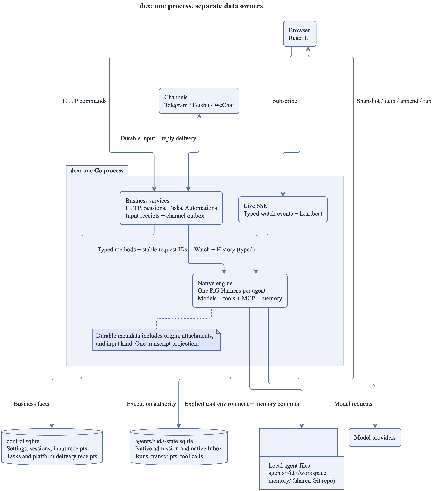
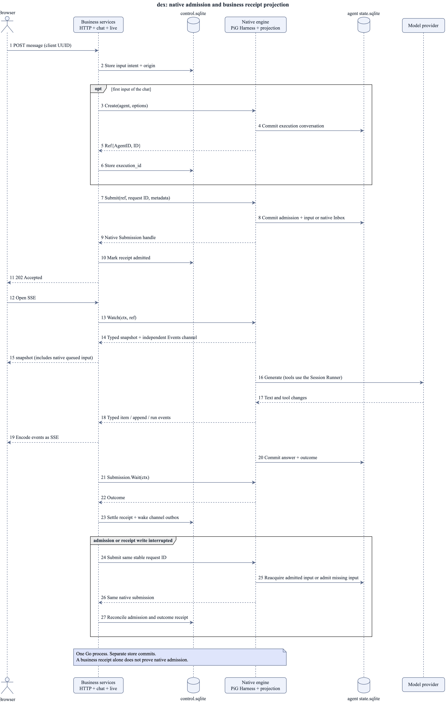

# Architecture

## Runtime overview

Source: [architecture.puml](../assets/src/architecture.puml).

Dex runs HTTP, channels, business services, and bot execution in one Go
process. Business services call `internal/engine` directly. The engine uses
[PiG](https://github.com/MichaelKinsy/PiG) for execution, models, and MCP.
The browser receives typed transcript events through SSE.

## Runtime modules

`cmd/dex` and `apps/native/internal/inapp` supply the embedded `apps/web`
handler and the factories from `plugins/builtin` to `internal/app`. The app
connects services without importing plugin implementations. The server
mounts the supplied Web handler at `/`. See the
[package index](../../.agents/rules/implementation.md#modules).

The root `go.mod` serves both hosts. Core packages under `internal/` do not
import `apps/`. `cmd/dex` does not import `apps/native/`, NSGo, the PiG TUI,
or the PiG extension host. `cmd/dex-agent` does not depend on `apps/`,
`internal/app`, `internal/settings`, `internal/session`, or `internal/engine`.
Production entry points do not link test helpers. The `check:native` task
checks these boundaries.

The native app starts and stops the local runtime when the Owner opens or
leaves a local workspace. iOS and macOS load `dex-local://workspace`.
Android intercepts `https://local.dex.internal`. The local bridge dispatches
API calls directly to an `http.Handler` and forwards SSE without a TCP
listener. A remote workspace uses the server's origin and sign-in. It has
no local bridge. See [native storage and setup](../../apps/native/README.md).

## Service and updates

`cmd/dex` manages per-user services and CLI updates. See
[service commands and recovery](../../README.md#run-and-manage-dex).
`internal/server` serves `/api/system/*` through `internal/host/sysops` for release
settings, upgrade progress, restart, hot backups of `control.sqlite` in
`<data dir>/backups/`, and recent logs from an in-memory buffer. Upgrade verifies the replacement binary before
an in-place restart via `syscall.Exec`.

`session.Service` owns the two-minute maintenance lease. The engine closes
admission and checks active operations, durable work, settlement, and memory
commits. If busy, it reopens admission. A global gate orders receipt commits,
withdrawal, and Monitor cancellation with lease confirmation. After confirmation,
Web input gets `409` before receipt creation. Earlier commits can return `202`
and remain pending. Channel input can also retain a pending receipt. Clients
retry with the same request ID. Lease release or expiry resumes admission.
A restart clears the in-memory lease. The gate also blocks new transcript
acquisitions that can open a Harness, without closing existing subscriptions.

## Data ownership

`control.sqlite` holds settings, Bots, Sessions, input receipts, channel
pairings, queues, Tasks, and plugin data. Core and plugin migrations own
separate tables. See [plugin migrations](plugins.md#plugin-migrations).

Each `<data dir>/agents/<id>/` holds a workspace, artifacts, `.agents/`, and
`state.sqlite`. Only the engine opens the execution store. It owns native
admission, the native Inbox, runs, transcripts, and tool calls. Business
services use typed engine calls. A file lock prevents two runtimes from
opening the same data directory.

## Message flow

Source: [message-flow.puml](../assets/src/message-flow.puml).

1. The client sends a message with a request ID. The session service saves
   its intent and origin. It rejects ordinary input without a selected model.
2. The session service creates and links an execution conversation on first
   use. It calls `Bots.Submit` with the stable request ID. PiG commits admission
   before returning a handle. Only then does control write `admitted_at`.
3. If either write fails, reconciliation submits the same ID. A pending
   business receipt alone does not prove native admission. Sessions have
   independent delivery gates and retry delays. Receipt insertion order sets
   the order within a Session. See [slow input diagnosis](sessions.md#diagnose-a-slow-session-input).
4. The engine runs the model and tools. `live.Hub` streams the engine's typed
   events. Queued input comes from the native Inbox.
5. The session service stores the native outcome. The same transaction adds
   any eligible channel reply to the Outbox. See [reply routing](sessions.md#input-and-replies)
   and [shared delivery](channels.md#shared-channels).

The two stores do not share a transaction. An interrupted creation or fork can
leave an unreferenced native conversation. A restart reacquires admitted work
by request ID. It does not guarantee that external actions occur once.

## Startup and shutdown

Startup registers saved provider credentials and static models before HTTP
starts. Network discovery runs in the background. `GET /api/health` exposes
readiness as `runtimeReady`. Health and Settings remain available during
discovery. A cold Bot cannot open during discovery, so its receipts can stay
pending. History, reload, and model checks that need discovery return `503`.
SSE clients reconnect. Cold open loads shared extensions and MCP before
publishing a Harness. Each Session opens its Runner lease after that barrier.

Shutdown cancels and joins discovery. The cleanup path also handles startup
failure. It stops scheduler jobs and Channels before the session consumer,
then closes execution resources and business storage. Recovery registers
interrupted child work before Harness resume. Reload or an ended native watch
closes its SSE stream. The browser reconnects for a new snapshot.

## Security

The Local Runner and control-host stdio MCP servers run as the Dex user. They
can read files that user can read. A Machine Runner uses its own account's
permissions. See [Runner selection](sessions.md#session-runners) and
[tool environment and vault](skills-and-integrations.md#tool-environment-and-mcp).

The HTTP API checks access tokens on non-loopback listeners and uses
`http.CrossOriginProtection` for cross-site writes. Before exposing the
loopback listener through a proxy, follow the [HTTPS setup](../../README.md#deploy-an-https-entry-point).
Paired private input has Owner authority. Revoking a pairing ends its reply
route without revoking input that Dex already accepted.

Dex creates its data directory with mode `0700`. Restrict access to the
complete directory and its backups. `control.sqlite` can contain plaintext
provider and channel credentials, Source secrets, and message bodies. Managed
Telegram credentials, vault entries, and MCP OAuth grants use private encrypted
files. Treat shared memory as input data. A poisoned memory entry can reach
later Sessions; Git history records the edits.

## Subsystems

- [Bots](bots.md): settings, memory, and archive.
- [Sessions](sessions.md): Main, child sessions, and Runners.
- [Tasks](tasks.md): Board, Task access, and external runs.
- [Plugins](plugins.md): optional Task Sources.
- [Execution](execution.md): engine, transcript, Monitors, and Processes.
- [Files](files.md): artifacts, uploads, and channel file delivery.
- [Channels](channels.md): pairing, Webhook Queue, and Outbox.
- [Skills and Integrations](skills-and-integrations.md): skills, MCP, vault, and reload.
- [Automations](automations.md): schedules, runs, and results.
