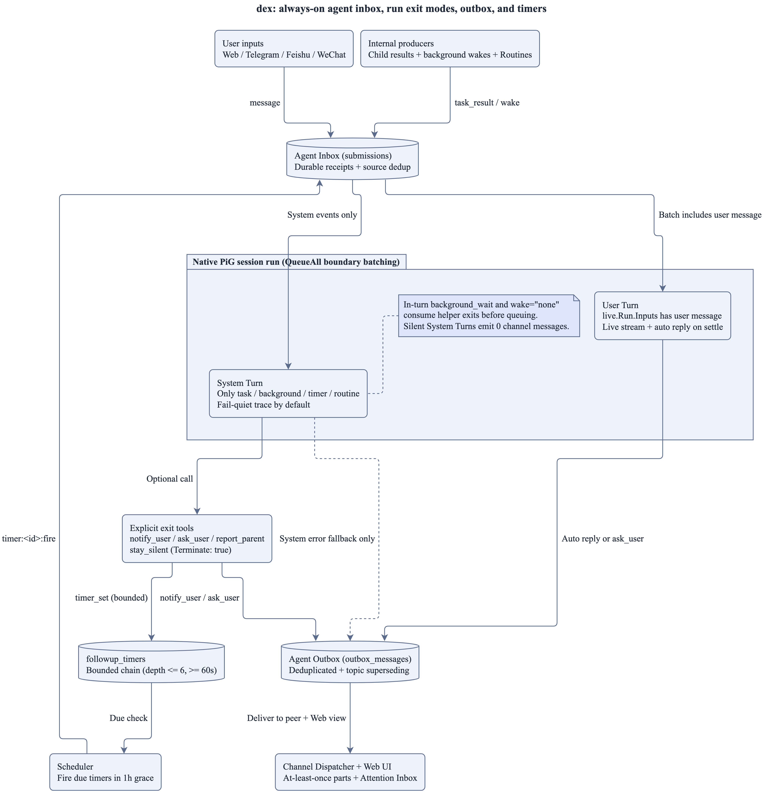

# 0023: Always-on agent inbox, outbox, and follow-up timers

Date: 2026-11-18
Status: Proposed. Refs #158.

## Context

In dex, `submissions` in `control.sqlite` acts at the same time as the event
inbox, the execution receipt, and the channel reply outbox
([architecture](../architecture.md#sources-of-truth)). Nine `channel_*` columns
live on `submissions`, while `routine_notification_deliveries` and
`channel_commands` maintain separate outbound state.

Three mechanisms amplify background work into extra model runs and unwanted
channel messages:

1. **Unconsumed helper wakes and single-item follow-ups.** `background_start`
   ([background_tools.go](../../../internal/engine/background_tools.go)) offers
   only `wake = "exit"` and `wake = "lines"`. When a session starts several
   short background commands and reads their log files in the same turn, their
   `background:<id>:end` rows still stay queued after the turn settles. Native
   execution sets `SteeringMode: durable.QueueAll` in
   [agents.go](../../../internal/engine/agents.go), while `FollowUpMode` stays
   unset (`QueueOne`), so $N$ queued events run $N$ sequential turns.
2. **Child background bubbling.** `CreateBackgroundWake` in
   [background.sql](../../../internal/db/queries/background.sql) copies
   `parent_request_id` from the starting input. Each background wake in a child
   session settles as a parent turn, so `sendResult` in
   [session_result.go](../../../internal/chat/session_result.go) inserts another
   `task_result` into `Main` with the user's channel `origin`.
3. **Forced channel replies on every completed input.** `sessionRules` in
   [session_tools.go](../../../internal/engine/session_tools.go) requires text
   at the end of every result turn, and `ListChannelReplies` in
   [channels.sql](../../../internal/db/queries/channels.sql) sends every `done`
   answer to the channel. After the user already received the complete answer,
   late background completions still deliver one channel message each.

Dex also has recurring Routines ([ADR 0005](0005-automations.md)), but lacks a
session-scoped follow-up timer for bounded checks inside `Main` or `Chat`.

### Terminology

Dex separates three concepts that previously shared the name "inbox" or
"outbox":

| Term                    | Store or route    | Purpose                                                                           |
| ----------------------- | ----------------- | --------------------------------------------------------------------------------- |
| **Agent Inbox**         | `submissions`     | Durable events waiting for an agent session to run.                               |
| **Agent Outbox**        | `outbox_messages` | Durable messages that an agent sends to a user channel or surfaces on a timeline. |
| **Web Attention Inbox** | `GET /api/inbox`  | The user-facing list of unread proactive findings, questions, and routine alerts. |

## Decision

Source: [always-on-flow.puml](../../../assets/src/always-on-flow.puml).

### 1. Agent Inbox: source hygiene and boundary batching

Keep `submissions` as the single durable Agent Inbox. Do not add a second
`inbox_events` table.

- **In-turn background helpers and waits.**
  - Add `wake = "none"` to `background_start` (`"exit"` remains the default).
    `background_commands` still tracks the process group, output limit, timeout,
    and session `Stop`, and `storeEnd` writes no wake submission when the
    command exits.
  - Add `background_wait(ids, timeout)` to the `background` extension. The tool
    waits in the current turn (up to `timeout` seconds) for the selected
    commands of the calling session to reach a terminal state, returns their
    exit statuses and bounded output tails, and marks their terminal wake
    consumed in `control.sqlite` so `storeEnd` inserts no `background:<id>:end`
    row.
- **Keep child background wakes local.** `CreateBackgroundWake` stops copying
  `parent_request_id`. A background wake in a child session wakes only that
  child session.
- **Batch queued follow-ups at run boundaries.** Set
  `FollowUpMode: durable.QueueAll` alongside `SteeringMode: durable.QueueAll` in
  [agents.go](../../../internal/engine/agents.go). While a session is busy,
  queued user messages and queued system events enter the next run together as
  one batch. Every native submission placed in that batch settles with the same
  answer entry; Outbox deduplication and `(result_child_id, native_answer_id)`
  uniqueness emit at most one outbound record per batch.

### 2. Run exit modes: interactive User Turns vs fail-quiet System Turns

Classify each run from the persisted inputs in `live.Run.Inputs` (using the same
run-input lookup as `taskSource` in
[session_tools.go](../../../internal/engine/session_tools.go)):

- **User Turn:** `live.Run.Inputs` contains at least one direct user `message`
  (`origin` is `web`, `telegram:*`, `feishu:*`, or `wechat:*`), including a user
  message that joined a running turn through `steer` or a `QueueAll` batch.
- **System Turn:** `live.Run.Inputs` contains only non-user inputs
  (`task_result`, `background:*`, `timer:*`, or `automation` prompts).

#### Exit behavior

- **User Turn.** Keeps Web SSE streaming and Telegram/Feishu live previews
  unchanged. When the run settles `done` and did not end through `ask_user` or
  `notify_user(final=true)`, settlement inserts one `reply` row into
  `outbox_messages` with the final answer and binds queued reply files. An
  `unanswered` run (except `stopped` and `withdrawn`) inserts an error reply.
- **System Turn (fail-quiet by default).** Starts no channel preview. Thinking,
  tool calls, and plain assistant text stay in the native transcript as internal
  trace. In the Web timeline, internal trace under a `task` or `timer` mark
  folds into the compact event row unless the run sent an Outbox message or
  failed. Settling a `done` System Turn writes **no** automatic row to
  `outbox_messages`. Even if the model writes an internal summary, no channel
  message is sent unless the model called `notify_user` or `ask_user`.
- **Child-to-parent reporting.** Direct parent turns (`session_new`,
  `session_send`, `session_fork`) emit one `task_result` to
  `conversations.parent_id` when they settle `done` without calling
  `stay_silent`. System Turns in a child session (such as `background:*` wakes)
  are fail-quiet by default and emit a `task_result` only when the child calls
  `report_parent` or when an unhandled failure or restart interruption occurs.

#### Tools

| Tool              | Scope                           | Arguments                                       | Behavior                                                                                                                                         |
| ----------------- | ------------------------------- | ----------------------------------------------- | ------------------------------------------------------------------------------------------------------------------------------------------------ |
| `notify_user`     | `Main`, writable `Chat`         | `content`, `topicKey?`, `final?` (default true) | Inserts a `proactive` row into `outbox_messages` keyed by tool task ID. With `final=true` as the sole call, sets `ToolControl{Terminate: true}`. |
| `report_parent`   | Child sessions (System Turns)   | `content`, `final?` (default true)              | Inserts one `task_result` to `conversations.parent_id` keyed by tool task ID. With `final=true` as the sole call, terminates the turn.           |
| `stay_silent`     | Child sessions and System Turns | `reason`                                        | Sole call in its round; sets `ToolControl{Terminate: true}`. Rejects the call if `live.Run.Inputs` contains an unanswered user `message`.        |
| `ask_user`        | `Main`, writable `Chat`         | `question`, `options`                           | Unchanged `Terminate: true` contract; writes a `question` row to `outbox_messages` in the settlement transaction.                                |
| `background_wait` | Sessions with `background`      | `ids`, `timeout?`                               | Waits in-turn for selected commands of this session and consumes their exit wake.                                                                |
| `timer_set`       | `Main`, writable `Chat`         | `at?`, `delaySeconds?`, `timeZone?`, `prompt`   | Schedules a bounded follow-up timer on this conversation (Section 4).                                                                            |
| `timer_list`      | `Main`, writable `Chat`         | _(none)_                                        | Lists active and recent follow-up timers of this conversation.                                                                                   |
| `timer_cancel`    | `Main`, writable `Chat`         | `id`                                            | Cancels one `scheduled` timer of this conversation (and withdraws a still-queued `timer:<id>:fire` input when possible).                         |

### 3. Unified Agent Outbox (`outbox_messages`) and dispatcher

Add `outbox_messages` and `outbox_files` in `control.sqlite`:

- **`outbox_messages` columns:** `id`, `dedup_key UNIQUE`, `agent_id`,
  `conversation_id`, `source_submission_id`, `kind` (`reply`, `proactive`,
  `question`, `routine`, `system_error`), `peer` (empty for Web-only chats),
  `channel_context`, `topic_key`, `body`, `rendered_parts`, `delivered_parts`,
  `group_fallback`, `group_cursor`, `remote_ids`, `status` (`pending`,
  `delivered`, `superseded`, `revoked`, `failed`), `retry_at`, `error`,
  `read_at`, `dismissed_at`, `created_at`, `delivered_at`.
- **`outbox_files` columns:** temporary file snapshots keyed by `(agent_id,
  operation_key)`, attached to the Outbox row created by `notify_user` or User
  Turn settlement, and deleted by trigger when `status` leaves `pending`.

Dispatcher and continuity rules:

- **Topic superseding.** Inserting a row with a non-empty `topic_key` updates
  earlier rows of the same `conversation_id`, `peer`, and `topic_key` where
  `status = 'pending' AND delivered_parts = 0` to `status = 'superseded'` in the
  same transaction. Rows with `delivered_parts > 0` finish their frozen parts.
- **Failure fallback.** When a System Turn settles with an execution failure
  (`model_error`, `interrupted`, `turn_limit`, `restart_limit`) or leaves an
  incoming `failed` / `interrupted` / `unknown` system event unhandled,
  settlement inserts one `system_error` row into `outbox_messages` with
  `dedup_key = "error:" || submission_id`. Failures never vanish silently.
- **Routine convergence.** Routine settlement queues an `outbox_messages` row
  (`kind = 'routine'`, `topic_key = 'routine:' || automation_id`) only when
  `outcome IN ('changed', 'failed')` and `duplicate = 0`. `unchanged` runs send
  no channel notification.
- **Reported-message continuity.** Prompt assembly renders a bounded
  `recent-outbox` section with the last five delivered Outbox entries of the
  conversation so the model knows what the user already received, including
  after context compaction.
- **Upgrade drain.** A Goose migration copies any undelivered channel replies
  from `submissions` and pending `routine_notification_deliveries` rows into
  `outbox_messages` so `channel.Manager` reads one Outbox queue without losing
  in-flight deliveries.

### 4. Bounded session follow-up timers (`followup_timers`)

Add `followup_timers` in `control.sqlite`:

- **Columns:** `id`, `operation_key UNIQUE`, `agent_id`, `conversation_id`,
  `root_request_id` (the user `submissions.id` that authorized the chain),
  `source_submission_id`, `chain_depth INTEGER NOT NULL`, `due_at INTEGER NOT
  NULL` (UTC milliseconds), `time_zone TEXT NOT NULL` (IANA name), `prompt TEXT
  NOT NULL`, `state TEXT NOT NULL CHECK (state IN ('scheduled', 'fired',
  'cancelled', 'expired'))`, `fire_submission_id TEXT UNIQUE`, `created_at`,
  `updated_at`.
- **Bounded self-rescheduling.**
  - A User Turn sets `root_request_id = source.ID` and `chain_depth = 0`.
  - A System Turn (`task_result`, `background`, or `timer`) inherits
    `root_request_id` and sets `chain_depth = prior_depth + 1`.
  - Hard limits: `chain_depth <= 6`, minimum delay `60s`, maximum horizon `7d`,
    and at most `8` `scheduled` timers per conversation. A new user `message` in
    the conversation starts new chains at `chain_depth = 0`.
- **Scheduler, cancellation, and authority.**
  - `scheduler` claims due rows in a writer transaction after checking
    `state = 'scheduled'`, conversation not archived, and `db.RequireActive`.
  - Within the 1-hour grace window, the transaction marks `fired` and inserts
    `timer:<id>:fire` into `submissions` (copying `root_request_id`'s `origin`
    and `channel_context` for outbound routing only), then wakes `chat.Service`.
  - Past the 1-hour grace window, the transaction marks `expired` and inserts
    `timer:<id>:expired` so the missed check is recorded and reported.
  - Session `Stop`, `/clear`, and bot archive mark all `scheduled` timers of the
    affected scope `cancelled` in the same writer transaction.
  - Timer inputs remain system inputs. They never satisfy `ToolBotCaller` or
    owner-action Question checks; general side-effect approval stays in #154.

## Consequences and Rollout

Deliver the design in three independent phases:

1. **Phase 1 — Agent Inbox hygiene and batching:** `wake = "none"`,
   `background_wait`, local-only `CreateBackgroundWake`, and
   `FollowUpMode: durable.QueueAll`.
2. **Phase 2 — `outbox_messages` and System Turn exit contracts:** schema and
   upgrade migration, `notify_user`, `report_parent`, `stay_silent`, unified
   `channel.Manager` dispatch, `recent-outbox` prompt continuity, and folded Web
   System Turn traces.
3. **Phase 3 — `followup_timers` and Routine Outbox cutover:** timer schema,
   tools, scheduler firing, cancellation hooks, and Routine delivery cutover.

### Verification

- Use temporary SQLite stores, real native PiG execution, `ai.FauxProvider`, and
  local HTTP channel stubs (`mise run check`). Do not use mocks.
- Prove that eight short in-turn background helpers waited with
  `background_wait` produce zero trailing `background:<id>:end` submissions and
  zero extra channel deliveries.
- Prove that multiple system events queued behind an active run execute in one
  `QueueAll` batch, that silent System Turns send zero channel parts, that a
  steered user message promotes the run to a User Turn, and that unhandled
  System Turn failures emit exactly one `system_error` Outbox notice.
- Prove that `followup_timers` fire at most once across restarts, enforce
  `chain_depth <= 6` and `delay >= 60s`, expire cleanly past 1 hour, cancel on
  `Stop`, `/clear`, and archive, and cannot call bot-management tools.
