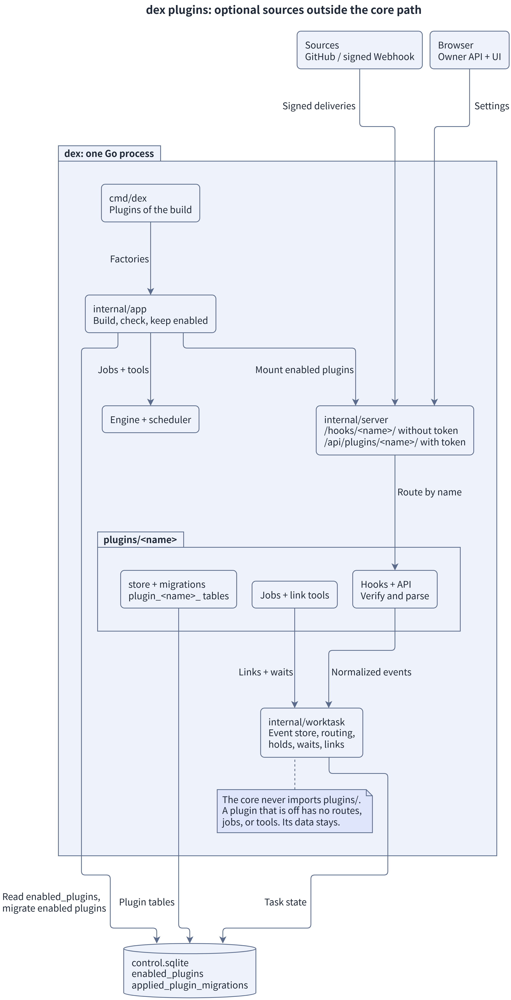

# Plugins

This document is for developers who change or add a plugin. A plugin is an
optional source of Task events, such as GitHub or a generic Webhook. It runs in the dex process, but its code and its behavior stay out of
the core path. The core works the same with every plugin off.

Source: [plugins.puml](../../assets/src/plugins.puml).

## Boundary

| Part                | Owns                                                                      |
| ------------------- | ------------------------------------------------------------------------- |
| `internal/plugin`   | The seam: `Plugin`, `Factory`, `Deps`, `Job`, `ValidSignature`, `Migrate` |
| `internal/app`      | Builds the plugins, reads `enabled_plugins`, and mounts the enabled ones  |
| `plugins/<name>`    | One source: hooks, API, migrations, queries, jobs, tools, event parsing   |
| `internal/worktask` | The event store, routing, holds, waits, links, and Task alerts            |
| `cmd/dex`           | The list of plugins in this build (`app.Config.Plugins`)                  |

The core in `internal/` never imports a package in `plugins/`. A plugin can
import the core, but not another plugin. Shared code that two plugins need goes
into `internal/plugin`. A plugin gets only `plugin.Deps`: the control database
and the Task event store. It writes Task state only through
`internal/worktask`, so every source shares one set of routing, hold, and
replay rules. A plugin sets the namespace of its events on the server, for
example `github.com/repository/<id>` or `webhook/<sourceId>`. A delivery cannot
choose the namespace, so one source cannot reach the objects of another.

## What a plugin adds

A `Factory` returns one `Plugin`. Each field is optional, and a zero field adds
nothing.

- `Hooks`: routes under `/hooks/<name>/`, without the access token. The server
  wraps them in `HookLimit`, the largest request body. A plugin that has hooks
  must set a limit. A hook authenticates its own deliveries, for example with
  `plugin.ValidSignature` for a `sha256=<hex HMAC>` header.
- `API`: routes under `/api/plugins/<name>/`, behind the access token.
- `Jobs`: scheduler jobs, named `<name>/<job>`. A job reads durable state, so
  a missed run is safe.
- `Tools`: Task link tools. The plugin parses the arguments into a
  `worktask.Link`. The core adds the Task `id`, checks the caller, and writes
  the link and an optional wait with the tool replay record. Each tool adds one
  paragraph to the Task rules.
- `Migrations`: the `migrations/*.sql` files of the plugin. A plugin without
  tables leaves it nil. See [Plugin migrations](#plugin-migrations).

## Lifecycle

1. At start, `internal/app` calls every factory of the build. A factory only
   builds handlers and starts no work.
2. dex rejects a name that is not lowercase ASCII letters, a name used twice,
   and hooks without a body limit.
3. dex keeps the plugins that have a row in `enabled_plugins`. A plugin
   without a row is off. The core migrations turn `github` on, because GitHub
   ran before plugins existed. dex logs a warning for an enabled name that is
   not in the build.
4. dex applies the migrations of each enabled plugin. If they fail, dex logs
   the error and skips that plugin. The core and the other plugins run, and
   `GET /api/settings/plugins` shows the error. The owner can turn the plugin
   off.
5. dex mounts the hooks and API of the enabled plugins, registers their jobs,
   and gives their tools to the engine.

The owner turns a plugin on or off with `PUT /api/settings/plugins/{name}` or
in General settings. `GET /api/settings/plugins` gives each plugin of the build
with its stored choice and whether it runs now. The choice applies after a
restart. Deliberate limit: reload the plugin routes, jobs, and tools in place
if restarts become a problem.

`GET /api/health` lists the running plugins in `plugins`. The web UI keeps the
components of a plugin in `web/src/plugins/<name>/` and renders them only when
the plugin runs. A plugin that is off has no hooks or API (`404`), jobs, tools,
or rules. Its tables, stored events, links, and waits stay. Task detail shows
each link as namespace, type, and key, so the core needs no plugin code to show
it.

## API, store, and schema

- The plugin operations in `api/openapi.yaml` carry the plugin name as their
  tag. The core server config excludes these tags. Each plugin generates its
  own strict server into `plugins/<name>/api` from
  `plugins/<name>/api/oapi-codegen.yaml`, which includes only its tag. The web
  client is generated from the whole spec.
- A plugin owns its queries in `plugins/<name>/queries` and generates
  `plugins/<name>/store` with its own `sqlc.yaml` target.
- A plugin owns its schema in `plugins/<name>/migrations`. Its `sqlc.yaml`
  target reads the core migrations and its own, because a plugin table can
  refer to a core table. The core target reads only the core migrations.

## Plugin migrations

Plugin migrations are goose SQL files, like core migrations, with these
differences:

| Rule          | Core migrations            | Plugin migrations                                    |
| ------------- | -------------------------- | ---------------------------------------------------- |
| Versions      | Timestamps on one timeline | `00001`, `00002`, ... for each plugin                |
| Version table | `goose_db_version`         | Rows of the plugin in `applied_plugin_migrations`    |
| When they run | Always, in `db.Open`       | At start, only for an enabled plugin, after the core |
| Table names   | No `plugin_` prefix        | `plugin_<name>_<table>`                              |
| References    | Never to a plugin table    | Can refer to core tables, but not to another plugin  |

`plugin.Migrate` gives goose a version store that keeps the rows of one plugin
in the shared table, so the versions of two plugins do not mix. Goose runs each
file in a transaction, so a failed file leaves no table and no version. Turning
a plugin off keeps its tables and rows. When it is on again, dex applies only
the new versions. dex has no uninstall step.

The first version of each current plugin adopts the tables that a core
migration made before plugin migrations existed. It creates each table only
if it does not exist, and then renames it with the `plugin_<name>_` prefix, so
an old database keeps its rows. A new plugin creates its tables with the
prefix directly.

## Add a plugin

1. Add `plugins/<name>` with `New(plugin.Deps) plugin.Plugin`.
2. Add its operations to `api/openapi.yaml` with tag `<name>`. Add the tag to
   `exclude-tags` in `api/oapi-codegen.yaml`, and add
   `plugins/<name>/api/oapi-codegen.yaml`.
3. If it stores data, add `plugins/<name>/migrations/00001_<name>.sql` with
   `plugin_<name>_` tables, embed it, and set `Migrations`. Add its queries in
   `plugins/<name>/queries` and a `sqlc.yaml` target. Its package tests call
   `plugin.Migrate` after `db.Open`.
4. Add the factory to `cmd/dex` and to the default list in the app test
   helper. Do not add an `enabled_plugins` row, so the plugin starts off.
5. Run `mise run generate:api` and `mise run generate:db`. The drift checks
   cover every `plugins/*` directory.
6. Add an E2E test that turns the plugin on, restarts dex, and uses its hook or
   API.

## Current plugins

| Plugin    | Default | Hook                                | API                                |
| --------- | ------- | ----------------------------------- | ---------------------------------- |
| `github`  | on      | `POST /hooks/github/{repositoryId}` | `/api/plugins/github/...`          |
| `webhook` | off     | `POST /hooks/webhook/{sourceId}`    | `/api/plugins/webhook/sources/...` |
| `email`   | off     | `POST /hooks/email/{sourceId}`      | `/api/plugins/email/sources/...`   |

## GitHub

The GitHub review adapter accepts a signed Webhook body or a page from the
GitHub REST API. Both use the repository ID as the namespace and the review
ID as the change key. A submitted review identifies the PR, the commit, and
the submission time. The adapter skips pending and dismissed reviews. Dex
records the author login and association. GitHub events from an `OWNER`,
`MEMBER`, or `COLLABORATOR` with a login can create a Task or resolve a wait.
Other authors can add to a linked Task's timeline, but cannot change waits.
External timeline entries carry a source event ID.

A signed `check_suite` delivery with the `completed` action adds one timeline
entry to each linked PR of this repository. The entry gives the app and the
conclusion. The change key includes the suite ID and its update time, so a
rerun adds a new entry and a redelivery does not. CI events are record-only.
They cannot create a Task, resolve a wait, send a Task alert, or be held as
unmatched. GitHub lists no PR for a branch in a fork, and Pull does not read
checks, so Dex does not record those suites.

The controller accepts signed deliveries at `POST /hooks/github/{repositoryId}`.
An administrator saves or rotates a write-only secret with
`PUT /api/plugins/github/webhooks/{repositoryId}` and disables the hook with
`DELETE` on the same path. Set `issueAgentId` to an active bot on the same PUT
to create Tasks for signed `issues.opened` deliveries. Omit it to disable Task
creation. Set `holdUnmatched` to hold Webhook and Pull events that match no
Task. The poller reads this flag from the Webhook configuration of the
repository, so Pull holds nothing for a repository without one. Dex first checks for an existing Issue link, then stores any new
Task, its link, and the opening event in one transaction. The issue title and
body are timeline data.
The hook does not accept the management token as a signature. It accepts a
request body of at most 2 MiB and returns `204` after the event commits or
when a signed delivery needs no action. A failed write returns `503`. To
receive deliveries from GitHub, expose only the hook path through a public
HTTPS proxy. Keep the management routes private.

The controller polls each PR configured through
`PUT /api/plugins/github/review-pulls/{repositoryId}/{pullNumber}` once per
minute. This API accepts a write-only GitHub token. `DELETE` on the same path
removes the configuration. The poller resolves the repository ID, reads up to
20 review pages, and uses the same event store as the hook. It saves an ETag
only after all entries are accepted and the result fits on one non-full page.
A failed pull leaves the checkpoint unchanged. A retry does not duplicate
previously committed reviews.

The owner can bind a PR to a Task with
`PUT /api/plugins/github/agents/{agentId}/tasks/{taskId}/pull`. Dex stores the
PR link and optional review wait in one transaction. Reviews on the linked
PR go to the Task timeline. Only a review of the specified revision, submitted
after the wait boundary, resolves that wait. Binding does not start a run.
Set `wait.alert` to `true` to send a Task alert when that review arrives.

## Webhook

The Webhook plugin accepts normalized Task events from a generic source, such
as a calendar bridge. It is off by default. A source sends signed deliveries to
`POST /hooks/webhook/{sourceId}`. An administrator saves the source with
`PUT /api/plugins/webhook/sources/{sourceId}` and disables it with `DELETE` on
the same path. The source ID uses lowercase letters, digits, and dashes. Each
delivery has an `X-Dex-Delivery` ID, which is the receipt key, and an
`X-Dex-Signature` header of the form `sha256=<hex HMAC of the body>`. The JSON
body has `type`, `objects` (1 to 16 typed references), and `occurredAt` (RFC
3339). Optional fields are `changeKey`, `revision`, `title`, `content`, and an
HTTPS `sourceUrl`. The namespace is `webhook/<sourceId>`. Dex sets it on the
server, so a source cannot reach the objects of GitHub or another source. The
author class is `SOURCE`. Set `taskAgentId` to create a Task for an unmatched
event with exactly one object, with `title` as the Task title. Set
`holdUnmatched` to hold other unmatched events. The hook accepts a body of at
most 2 MiB. The source uses the same event store, routing, holds, and Task
alerts as GitHub. It cannot add a wait, and it has no link tool.

## Email

The email plugin accepts forwarded mail of a selected address. It is off by
default. A mail forwarding service posts one raw RFC 5322 message as the body
of `POST /hooks/email/{sourceId}`, with the `X-Dex-Delivery` and
`X-Dex-Signature` headers of the Webhook plugin. An administrator saves the
source with `PUT /api/plugins/email/sources/{sourceId}` and disables it with
`DELETE` on the same path. The namespace is `email/<sourceId>`, and the author
class is `SOURCE`.

The parser uses only the Go standard library. The event type is
`email.received`, and the change key is the Message-ID, so a retry does not add
a second entry. `Message-ID`, `In-Reply-To`, and `References` become `message`
objects, newest first, up to 16. A key longer than 200 bytes becomes its
SHA-256 hash. The Subject is the Task title. The text is the first `text/plain`
part. Dex decodes quoted-printable and base64, and drops HTML parts, files, and
bytes that are not UTF-8. The From header stays in the text only, because
anyone can forge it.

Set `taskAgentId` to create a Task for a new thread, which has one object. A
reply finds the Task of a linked reference. A message whose references link to
different Tasks is a conflict. A reply to a thread that Dex never saw has more
than one object, so Dex holds it with `holdUnmatched` or ignores it. A message
above 2 MiB gets `413`, so the forwarder must remove large files first.

### IMAP Pull

IMAP Pull reads one folder of a mailbox for a source, so no forwarder is
necessary. An administrator saves it with
`PUT /api/plugins/email/sources/{sourceId}/imap`, with the address, the user
name, the password, and the folder (default `INBOX`). `DELETE` on the same path
stops it. Deleting the source also deletes its Pull. The password is
write-only. Use an app password. The `email/imap-pull` job runs every minute.

- Address: `imaps://host[:port]` (default port 993, TLS 1.2 or later).
  `imap://` without TLS is accepted only for a loopback host.
- Read-only: Dex opens the folder with `EXAMINE` and reads bodies with
  `BODY.PEEK`, so it does not set `\Seen` or change the mailbox.
- Start: the first run, and every UIDVALIDITY change, start after the newest
  message. Dex does not import old mail.
- Cursor: Dex stores the last UID that it handled. One run reads at most 50
  messages. A network or store failure keeps the cursor, so the next run reads
  the message again. A message above 2 MiB, or one that is not a valid email,
  is skipped with a warning.
- Dedupe: Pull and the hook share the change key, the Message-ID. A message that
  arrives by both paths adds one entry.
- Each save resets the cursor, so the next run starts after the newest message.

The client is `github.com/emersion/go-imap/v2`, because the standard library
has no IMAP client.
