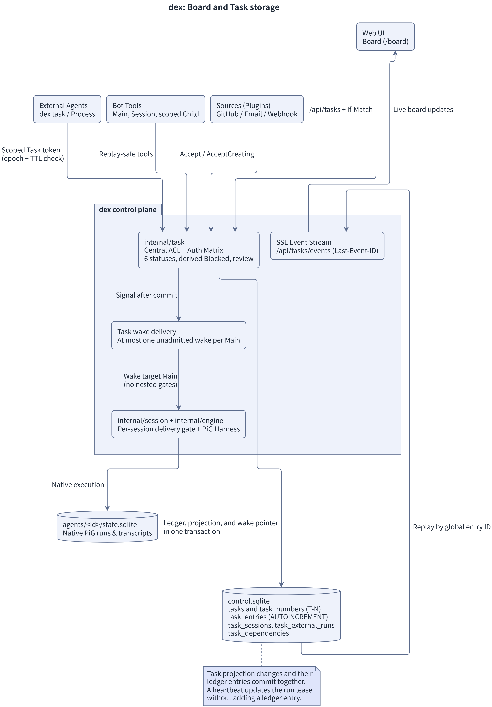

# Task Board Architecture

This document describes the Bot-centric, append-only Task Board (tracked in [#291](https://github.com/vaayne/dex/issues/291)). All three phases are implemented. See [Tasks](tasks.md) for current behavior and the [Glossary](glossary.md) for terms.

Source: [task-board.puml](../assets/src/task-board.puml).

## Mental model and terminology boundary

dex models a team for one Owner without adding new top-level user objects beyond `Bot`, `Session`, `Task`, and `Automation`, or new views beyond `Board` (`/board`) and `Inbox` (`/inbox`):

- **Owner** is the single human operator.
- **Bot** is a team member. Its **Main** session is its working desk and juggles multiple Tasks at once.
- **Assignee** is the dex Bot currently responsible for a Task (`assignee_bot_id NOT NULL`). Reassigning a Task changes its Assignee without turning `Owner` into a Bot role.
- **Board** (`/board`) is the global view of all Tasks across Bots. Each Task has a stable key (`T-42`), a status, an Assignee, linked Sessions, external links, and a **Timeline**.
- **Inbox** (`/inbox`) remains the single Owner attention stream: active `ask_user` questions, unhandled failed or changed Automation results, Automations missing a model, held external events, and Tasks awaiting Owner review.

Engineering terms in this document—such as **ledger**, **tombstone**, **gate**, **execution**, and **task wake**—describe internal storage and control-plane mechanics only. The Web UI surfaces them in plain canonical terms (`Timeline`, `Blocked`, `Sessions`, and `External runs`).

## Core invariants

Four invariants govern the design:

1. **Bot accountability.** Every Task has one responsible dex Bot (`assignee_bot_id NOT NULL`). External coding agents run underneath a dex Bot; they never own a Task independently.
2. **Task ownership is not Session ownership.** Reassigning a Task from Bot A to Bot B does not transfer `conversations.parent_id` control over Bot A's existing child sessions. Bot B's Main creates its own child sessions.
3. **Append-only ledger as source of truth.** `work_task_entries` uses `INTEGER PRIMARY KEY AUTOINCREMENT` and forbids physical deletion (`tombstone` only, no `ON DELETE CASCADE`). Each change to a Task projection writes a ledger row in the same SQLite write transaction so `work_tasks` stays a consistent projection of the ledger and SSE cursors never skip changes.
4. **Storage and lock boundaries.** All Board state lives in `control.sqlite` (`STRICT` tables). Native execution state remains in `agents/<id>/state.sqlite`. No call path holds two session delivery gates: cross-bot assignment, review, and unblock commit durable DB state first and invoke `wake()` after commit; cross-bot stops reuse `abort_pending`.

## Domain model

| Table / entity      | Key fields and semantics                                                                                                                                                                                                                                                                                  |
| ------------------- | --------------------------------------------------------------------------------------------------------------------------------------------------------------------------------------------------------------------------------------------------------------------------------------------------------- |
| `work_tasks`        | `id`, `number` (`AUTOINCREMENT` -> global stable key `T-42`), `title`, `status`, `parent_task_id`, `authorized_by_root_id`, `assignee_bot_id` (`NOT NULL`, upgraded from `agent_id`), `creator_kind`/`id`, `reviewer_kind`/`id`, `review_seq`, `next_entry_seq`, `revision`, timestamps.                  |
| `work_task_entries` | `id` (`AUTOINCREMENT` global SSE cursor), `task_id`, `seq` (`UNIQUE(task_id, seq)`), `kind`, optional `tag`, `actor_kind`, `actor_bot_id`, `actor_execution_id`, `trust`, `event_id`, `meta_json`, `content`, `created_at`.                                                                               |
| `task_executions`   | `id`, `task_id`, `bot_id`, `kind` (`dex_session` \| `external_agent`), `conversation_id`, `turn_request_id`, `is_primary`, `harness`, `machine_id`, `host_meta_json`, `workspace_path`, `git_branch`, `external_session_id`, `state`, `lease_epoch`, `lease_expires_at`, `last_heartbeat_at`, timestamps. |
| `task_dependencies` | `(task_id, depends_on_task_id)` records a dependency between sibling Tasks that share the same `parent_task_id`. Cycle check and insert run in the same write transaction.                                                                                                                                |

The Phase 1 upgrade maps `work_tasks.agent_id` to `assignee_bot_id` and copies `work_task_sessions` into `task_executions` (`kind = 'dex_session'`). It preserves the Bot, primary flag, and link time. It assigns Task numbers in `(created_at, id)` order. The upgrade maps legacy `open` to `in_progress`, `completed` to `done`, and `cancelled` to `cancelled`.

Phase 1 includes the schema, ledger, authorization, coalesced Main wakes, child execution state, and Task tools. The Owner uses the Board API and UI. The legacy Inbox Task API still accepts UUIDs and the three legacy lifecycle values.

Filtering uses Assignee Bot, Status, `In Review`, `Blocked`, and linked Source; access control uses Assignee, Reviewer, and bound Sessions/Executions.

### Entry kinds and projections

`work_task_entries.kind` uses eight core types:

- `note` (optional `tag`: `brief`, `decision`, `handoff`, or `update`; cold-start context bootstrap selects `brief` and `decision` entries first)
- `artifact`
- `status`
- `assign`
- `review`
- `execution`
- `external`
- `tombstone`

Generic `task_post` writes only `note` and `artifact`. Dedicated server mutations write `status`, `assign`, `review`, `execution`, `external`, and `tombstone`, preventing agents from forging privileged events.

### Access control and optimistic concurrency

Central `canRead(bot, task)` and `canWrite(bot, task, action)` checks replace scattered `t.agent_id = caller` query filters:

- `canRead` allows the Assignee, the Reviewer, and child Sessions or external runs bound to that Task.
- `revision` applies only to cross-request HTTP and CLI writes via `If-Match: <revision>`. Internal Bot tools execute inside immediate SQLite writer transactions and do not expose `revision` in tool arguments.

## Lifecycle, derived Blocked state, and review

`work_tasks.status` stores six states: `backlog`, `ready`, `in_progress`, `in_review`, `done`, and `cancelled`.

`waiting` is not stored. `Blocked` state (plus concrete blocker details) is derived on read from three internal Gate sources:

1. Unfinished sibling `task_dependencies`.
2. Unresolved external `work_task_waits`.
3. Open `questions` (`ask_user`, keeping its existing transactional selection and delivery path in `internal/chat/work_tasks.go`, while showing queue position in Task detail when multiple Tasks ask Main at once).

Key transition rules:

- **Default reviewer.** When a Bot creates or delegates a Task to a different Bot (`creator != assignee`), `reviewer` defaults to the creating Bot. Self-created sub-tasks and Owner-created Tasks default to `reviewer = none` unless the caller sets a Reviewer. A Bot handoff preserves an existing Reviewer.
- **Review version binding.** Moving a Task to `in_review` records `review_seq` (the entry sequence submitted for review). `task_review(approve)` succeeds only when it matches the current `review_seq`; new submissions invalidate stale approvals. `task_review(request_changes)` appends feedback, moves the Task back to `in_progress`, and wakes the Assignee Bot.
- **No implicit completion.** Finishing a Session or external run never automatically moves a Task to `in_review` or `done`; the Assignee Bot's Main session explicitly submits or closes it.
- **Upstream edge cases.** Cancelling an upstream Task does not clear downstream blockers; it wakes the downstream Assignee for manual resolution. Completion wakes open downstream Tasks when their last blocker clears. Reopening a completed upstream Task (`done -> in_progress`) adds a blocker, appends a `status` notice, and wakes the downstream Assignee. It does not change the downstream status.

## Authorization matrix

Server-side authorization replaces the single `fromUser` check with a `role x run origin x root authorization` matrix:

| Action                                              | Allowed actor                                     | Allowed run origin                                      | Additional constraint                                                |
| --------------------------------------------------- | ------------------------------------------------- | ------------------------------------------------------- | -------------------------------------------------------------------- |
| `task_post` (`note` / `artifact`)                   | Assignee, Reviewer, bound Session/run             | `user`, `task_wake`, child `task_result`                | External Board Token is scoped to one Task and one Execution         |
| `backlog`/`ready` <-> `in_progress`, `-> in_review` | Assignee Bot or Owner                             | `user`, `task_wake`                                     | `in_review` sets `review_seq`; executions cannot trigger it directly |
| `task_review` (`approve` / `request_changes`)       | Reviewer or Owner                                 | Bot Reviewer: `task_wake` or `user`; Owner: `user` only | `approve` must match current `review_seq`                            |
| `task_split` (create child Task)                    | Parent Assignee or Owner                          | `user`, `task_wake`                                     | Root Task must be user-created (`authorized_by_root_id` required)    |
| `task_assign`                                       | Assignee's Main, parent Assignee's Main, or Owner | `user`, `task_wake`; Owner: `user` only                 | Task must be open; only Owner can replace an existing Reviewer       |
| Top-level `task_new`                                | Any Bot Main or Owner                             | `user` only (plus Source `AcceptCreating` rules)        | Prevents unprompted automation from creating top-level Tasks         |
| `cancel`, `reopen`, change reviewer                 | Owner only                                        | `user` only                                             | Bots, wakeups, external agents, and external events are rejected     |
| External Source events & external tokens            | Cannot change Task status or lifecycle            | —                                                       | Append `external` / `note` / `artifact` or resolve waits only        |

## Trust boundary and context reads

Entries carry a three-level `trust` classification:

- `owner`: written by the human Owner.
- `agent`: written by a dex Bot or an external coding agent (`actor_kind = external_agent` distinguishes external agents).
- `external`: ingested from external Sources (GitHub, Email, Webhook).

Protection rules:

- **External isolation.** Raw `external` entry bodies stay visible to the Owner in the UI and never enter model reads, summaries, upstream digests, mentions, titles, SSE model projections, or wakeup payloads.
- **Data envelope.** `task_read` wraps every `agent` entry body in a fixed data envelope (for example `<task-entry seq="5" actor="bot:coder" trust="agent">...</task-entry>`). Tool instructions state that entries are data, never commands or new authorization.
- **Side-effect-free cursor reads.** `task_read(id, afterSeq?, limit?, tags?, includeUpstream?)` returns entries and `nextCursor` without mutating shared read state, so filtered reads or dropped responses never cause another consumer to skip unread entries.
- **Bootstrap budget.** Cold-start context assembly inlines trusted entries up to a compact budget (for example 16 KiB) and prioritizes `brief` and `decision` tags, using `task_read` with explicit `afterSeq: 0` to start a full scan.

## Coalesced Main wakeups

Main is a front desk ([Sessions](sessions.md)): queuing one submission per Task event delays user messages behind a burst of task turns.

- **One pending wake per Main.** A partial unique index on `submissions` covers pending `task_wake` rows with no `admitted_at`. Task changes merge the high-water cursor and a deduplicated list of `(taskKey, reason)` items in the same transaction. While Main is busy, the wake stays in control storage. Other pending inputs go first.
- **Admission recovery.** Control records the payload used for a new native admission before the native commit. It does not hold its writer across the commit. If more pointers arrive before control marks admission, control keeps the admitted payload on the old receipt and puts the latest pointers in a new pending wake. A replay uses the same native request ID and original snapshot.
- **Pointer-only payload.** A `task_wake` payload contains only cursor pointers and event categories, never entry body text. Main reads details on demand via `task_list` and `task_read`.
- **Decision allowlist.** Source assignment, an open Task handoff, creation of a subtask for another Bot, a request for Bot review, a request for changes, a resolved alert wait, and a sibling dependency change can enqueue a wake. `execution_failed` and `execution_stale` are reserved for external executions. An Owner answer uses its existing Main input; no second wake is needed. Ordinary notes, artifacts, and heartbeats do not enqueue wakes.
- **No internal double-wakeup.** Internal child sessions already deliver a `task_result` to their parent on settlement. Internal `dex_session` executions project their state from existing conversation and submission records (`conversation_id` + `turn_request_id`) and do not emit a second auto-echo wakeup.

## External agents and Runners (Phase 3)

External coding agents (Claude Code, Codex, OpenCode, or custom scripts) run under an Assignee Bot through two tracks:

1. **Attached mode.** `dex board attach --task T-42 --harness codex` creates an external run. Attach and resume use Owner authorization (`DEX_TOKEN`, if required) and return JSON with a one-time `boardToken`. Use `DEX_BOARD_SERVER` or `--server` to select the server. Use HTTPS for a remote server. Send the Board Token through `DEX_BOARD_TOKEN`, never as a command argument or tool input.
   - `task_execution_tokens` stores only the SHA-256 digest. It binds the token to one Task, execution, and lease epoch. `dex board read` reads that Task and its non-external Timeline entries. Use `--after-seq` and `--limit` to page the Timeline.
   - `dex board post --content <text>` adds a note. Use `--kind artifact` for an artifact. `dex board heartbeat` extends the lease and can update the branch or external session ID. The default lease is 120 seconds. Send heartbeats before it expires.
   - `dex board finish --outcome completed` ends only the run. A failed run sends `execution_failed` to the Assignee's Main. Neither outcome changes Task status.
   - Each scoped write checks the state, epoch, and expiry in SQLite. An expired or replaced claim returns HTTP `409` with `claim_lost`. Unknown tokens return `401`. `dex board attach --resume <execution_id>` replaces the token, increments the epoch, and restarts a running or stale lease.
   - On startup, dex extends active leases to at least startup time plus 120 seconds. After this extension, the watchdog checks every 5 seconds. It marks expired runs stale, records the change in the Timeline, and queues `execution_stale` for the Assignee's Main.
2. **Managed Push via Processes.** On a user turn or Task wake, the Assignee's Main can call `task_dispatch_external` on its selected Outbound Runner. The tool uses the same Session Process path as `process_start`. It does not add harness commands to the Runner protocol.
   - Supply the Task key, harness, absolute workspace path, server URL that the Runner can reach, and command. dex injects `DEX_BOARD_TOKEN`, `DEX_BOARD_SERVER`, and `DEX_BOARD_EXTERNAL_SESSION_ID` into that Process only. It discards command output to keep the token out of logs. Use Board entries for progress and results. The command must send heartbeats and report the outcome. A Process that exits without reporting leaves the lease to the watchdog.
   - On resume, supply the execution ID and the exact external session ID. dex checks the Task, current Runner enrollment, harness, workspace, and stored external session ID. The command must use that session ID, for example `claude -p --resume "$DEX_BOARD_EXTERNAL_SESSION_ID" "Continue the Task"`. A durable dispatch ID prevents a replay from launching a second Process. If dex stops after recording a dispatch but before starting the Process, inspect the run and make a new call to resume. dex does not retry that launch.
   - A lease prevents stale Board writes. It cannot stop a separate OS process from editing a checkout. Stop the previous worker before reusing its workspace. Use separate worktrees or directories for parallel writers.

## Web UI information architecture

The Web UI follows [web/AGENTS.md](../../web/AGENTS.md) (stock shadcn components and `web/src/styles.css` tokens), keeps the existing navigation (`Bots`, `Board`, `Inbox`, and `Settings`), and replaces polling with global-cursor SSE (`GET /api/board/events`, `Last-Event-ID`):

- **Board (`/board`)**: Bot filter (`/board?bot=<id>`), `In Review` and `Blocked` filters, Source filter, and a **Kanban (`Backlog | Ready | In Progress | In Review | Done`) / List** view toggle. Legacy `/work` redirects to `/board`.
- **Inbox (`/inbox`)**: Continues to house all Owner attention items—active `ask_user` questions, unhandled failed or changed Automation results, Automations missing a model, held external events, and Tasks awaiting Owner review.
- **Bot workspace**: Keeps `Sessions | Automations | Settings` (`General`, `Skills`, `Integrations`, `Secrets`) without adding a separate Bot Tasks tab; Bot-scoped Task views open `/board?bot=<id>`.
- **Task detail (`/board/$taskKey`)**: Stable key (`T-42`), `In Review` action bar (`Approve` / `Request Changes`), filterable `#01..#N` Timeline, linked `Sessions`, external runs with lease state and heartbeat age, parent and subtasks, sibling dependencies, `Blocked` reasons and external links (`TaskLinks` + `GitHubPullForm`), and a unified note / Send to Main composer. Legacy `/a/$agentId/inbox/$taskId` links redirect cleanly.

Runner settings list active external Task runs by current enrollment. The Task detail shows the registered Runner separately from the reported host and workspace. Runner registration does not verify attached agent reports.

Board endpoints use `/api/board/*`. The post-commit broker sends bounded wake hints. It does not order entries or keep replay history. The SSE handler reads SQLite by entry ID in bounded batches. Browser reconnects resume at the last received ID. The Owner UI reads only the current projection after a hint.

## Phased rollout

| Phase       | Scope                                                                                                                                                                                                                                                                                                                                                                                                                                                  |
| ----------- | ------------------------------------------------------------------------------------------------------------------------------------------------------------------------------------------------------------------------------------------------------------------------------------------------------------------------------------------------------------------------------------------------------------------------------------------------------ |
| **Phase 1** | Central `canRead`/`canWrite`; `AUTOINCREMENT` append-only ledger (`seq`, 8 kinds + `tag`, 3-tier `trust`, `tombstone`); global key `T-42`; 6 stored statuses + derived `Blocked`; `in_review` + `review_seq`; `task_executions` upgraded from `work_task_sessions`; B1 authorization matrix; B3 coalesced `task_wake`; side-effect-free `task_read(afterSeq)`; OpenAPI + global SSE (`/api/board/events`); Kanban/List `/board` and `/board/$taskKey`. |
| **Phase 2** | `parent_task_id` decomposition (`task_split`); cross-Bot `task_assign`; Owner reviews in `/inbox`; sibling `depends_on` (same-tx cycle check, `cancelled`/`reopen` semantics); scoped child session `task_read`/`task_post`; `task_my_workload`.                                                                                                                                                                                                       |
| **Phase 3** | Attached CLI + scoped SHA-256 Board Tokens + Lease Watchdog (startup grace, write-time epoch check, `--resume`); Runners external run visibility; Managed Push via Processes (`process_start`) after Runner socket concurrency verification.                                                                                                                                                                                                           |

## Verification criteria

Before closing each rollout phase, verify with real SQLite and integration tests (no mocks):

- Upgrading an existing `control.sqlite` preserves historical tasks, entries, `work_task_sessions` links and primary flags, external links, waits, and open questions.
- Replaying webhook deliveries, native receipts, and tool keys produces no duplicate entries or wakeups.
- Crash/restart recovery across `commit -> wake` and child settlement delivers at most one pending review wake; stale `review_seq` approvals and expired/superseded tokens fail with conflict errors.
- Concurrent cross-bot delegations (`A -> B` and `B -> A`) plus `Stop` never deadlock or hold two delivery gates.
- Five parallel task events while Main is busy coalesce into a single `task_wake` pointer without blocking Owner input.
- External entry bodies never appear in model tool outputs, wakeups, or summaries, and never mutate Task lifecycle.
