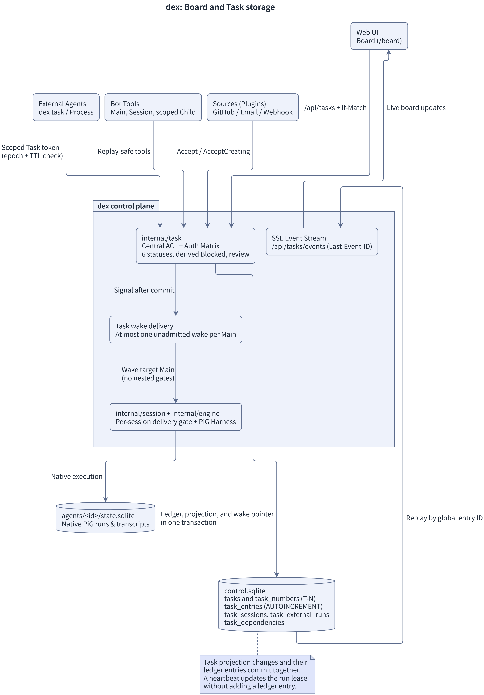

# Tasks

A Task is a work item with a stable key such as `T-42` and one responsible
Bot, its Assignee. A Task can link Sessions across Bots. It does not own their
execution. Reassignment changes which Bot receives Task messages and wakes.
It does not transfer control of Sessions or existing questions.

Source: [task-board.puml](../assets/src/task-board.puml).

## Board

Board (`/board`) is the global workspace across Bots. Use `/board?bot=<id>`
to limit the view to one Bot. Quick add creates a Task without starting a Session.

- **Needs you** shows active questions, Tasks awaiting Owner review, enabled
  Automations without an available model, and held Source events. A bound
  Automation uses its target Session's model settings for this check.
- **Blocked** shows Tasks with blockers. A blocker alone does not count as an
  Owner attention item.
- **Active** shows other open Tasks except backlog Tasks. **Later** shows the
  backlog. **Completed** contains closed Tasks and is collapsed by default.
- **Updates** groups unhandled [Automation results](automations.md) by
  Automation. Open a result at `/board/results/$runId`.

`GET /api/board/attention` supplies active Sessions, questions, Automation
setup flags, unhandled results, and Owner reviews. Held events come from
`GET /api/sources/held-events`. The Web UI uses both responses for the Board
badge. It uses the same attention data for Bot status. See [Web UI](../../apps/web/AGENTS.md).

Task detail (`/board/$taskKey`) shows status, Assignee, Reviewer, blockers,
linked Sessions and runs, related Tasks, external links and waits, and the
Timeline. The composer sends to the Assignee's Main by default. Select
**Note only** to add a Timeline entry without starting a turn.

## Storage and HTTP API

Task state lives in `control.sqlite`. See [data ownership](architecture.md#data-ownership)
for the native execution store.

| Table                   | Purpose                                                                                                                                    |
| ----------------------- | ------------------------------------------------------------------------------------------------------------------------------------------ |
| `task_numbers`          | Allocates a global number with an `AUTOINCREMENT` insert. `tasks.number` stores the result.                                                |
| `tasks`                 | Stores the current projection, including Assignee, Reviewer, status, parent, root authorization, revision, and entry and review sequences. |
| `task_entries`          | Stores the append-only Timeline. `seq` is unique within a Task. The `AUTOINCREMENT` entry ID is the global event cursor.                   |
| `task_dependencies`     | Stores edges between subtasks of the same parent.                                                                                          |
| `task_sessions`         | Links Sessions to Tasks and stores the primary link and first parent turn outcome.                                                         |
| `task_external_runs`    | Stores external runs, including their leases and Runner bindings.                                                                          |
| `task_execution_tokens` | Stores scoped tokens for external runs.                                                                                                    |

Projection changes and their ledger entries commit in the same transaction.
Entries store actor and trust data. The entry kinds are `note`, `artifact`,
`status`, `assign`, `review`, `execution`, `external`, and `tombstone`. Reads
omit tombstones and the entries they retract. The server has no tombstone
write API. Generic posts accept only `note` and `artifact`. Dedicated
mutations write lifecycle, execution, and Source entries.

The Owner lists and creates Tasks at `/api/tasks`. Detail and write paths
accept a key or UUID. Archiving a Bot hides its assigned Tasks from Board
without deleting them. The Owner list and detail return all matching Tasks and
the full visible Timeline, respectively. They do not use Timeline pagination.
The [HTTP contract](../../api/openapi.yaml) identifies writes that accept an
optional `If-Match` revision. A stale revision returns `412` and makes no
change. Approval uses `reviewSeq` instead. Bot tools check and apply writes
in one SQLite write transaction and do not take a revision. Scoped
`dex task` commands do not send `If-Match`.

`GET /api/tasks/events` starts at the ledger head unless the client supplies
`Last-Event-ID` or `after`. The handler reads SQLite in bounded batches and
sends `task_entry` events in entry ID order, with Task IDs and no entry text.
`task_ready` marks the catch-up cursor. `task_refresh` invalidates projections
without advancing the cursor, for changes such as questions or execution
state. The post-commit broker sends hints and keeps no replay history.

## Lifecycle and review

The stored status is `backlog`, `ready`, `in_progress`, `in_review`, `done`,
or `cancelled`. Dex derives **Blocked** for open Tasks from unfinished
sibling dependencies, unresolved waits, and open Task questions.

A subtask inherits the root authorization of its parent and keeps its own
Assignee and status. Dex checks for dependency cycles in the same transaction
that adds the edge. Completion can wake an open downstream Task when its last
blocker clears. Cancelling or reopening an upstream Task can wake its open
downstream Tasks with a notice. It keeps or restores the blocker without
changing their status.

Only an `in_progress` Task can enter review or go directly to `done`. Direct
completion requires no Reviewer. Submission for review records `review_seq`.
Approval moves the Task to `done` and must match the current `reviewSeq`.
A stale approval returns `409`. A request for changes requires a note, moves
the Task to `in_progress`, and wakes the Assignee's Main. Session or run
completion does not change Task status. On the turn of a native child result,
the Assignee's Main checks the acceptance conditions and can request `done` or
`in_review` with `task_update`. The lifecycle rules still apply. Dex makes no
automatic status change for the result.

Delegation to another Bot defaults to review by the delegating Bot if no
Reviewer is set. Owner-created and self-assigned subtasks have no Reviewer
by default. A handoff keeps an existing Reviewer. Only the Owner can change
an existing Reviewer, cancel an open Task, or reopen a closed Task.

## Access control

`internal/task` checks the caller's role, Session or run binding, and input
origin. The Owner can read Tasks across all active Bots. Main and top-level
Sessions can read Tasks for which their Bot is Assignee or Reviewer. A writable child can read only
Tasks linked to that exact Session. A scoped token grants access to one Task
and one external run. A child link does not give its Bot's Main access.

For Bot tools, **interactive** means a user turn or a `task_wake`. A child
result (`session_result`) can authorize a note or artifact. A **native child
result** is the `session_result` that Dex writes when a child turn settles
with a native answer. It has the child in `result_child_id` and the answer in
`native_answer_id`. A rejected, failed, or interrupted child turn, a
`session_report`, a child message, and the failure notice of a child input
without a parent turn give an ordinary child result. A Monitor or Process
`wake` cannot authorize Task writes. Reads do not require an interactive turn.

| Action                                                      | Bot access                                                                                                                            | Other access and limits                                          |
| ----------------------------------------------------------- | ------------------------------------------------------------------------------------------------------------------------------------- | ---------------------------------------------------------------- |
| Create top-level Task (`task_new`)                          | Main or top-level Session on a user turn.                                                                                             | Owner, or a Source under an explicit creation rule.              |
| Post note or artifact (`task_post`)                         | Assignee or Reviewer in Main or top-level Session, or a linked child. Requires an interactive turn or a child result.                 | Owner or scoped run token.                                       |
| Link external object (Source tool)                          | Assignee or Reviewer in Main or top-level Session. Requires an interactive turn or a child result.                                    | Owner.                                                           |
| Rename or link Session (`task_update`)                      | Assignee Main on an interactive turn, or Assignee top-level Session on a user turn. The Session must be a direct child of the caller. | Owner.                                                           |
| Start or move to `ready` or `backlog` (`task_update`)       | Assignee Main on an interactive turn.                                                                                                 | Owner. Lifecycle rules still apply.                              |
| Finish or submit for review (`task_update`)                 | Assignee Main on an interactive turn or a native child result. A Task with a Reviewer cannot go directly to `done`.                   | Owner. Lifecycle rules still apply.                              |
| Review (`task_review`)                                      | Reviewer Main on an interactive turn.                                                                                                 | Owner.                                                           |
| Create subtask (`task_split`)                               | Parent Assignee Main on an interactive turn.                                                                                          | Owner. The parent must be open and have user root authorization. |
| Reassign open Task (`task_assign`)                          | Assignee Main or the parent Assignee's Main on an interactive turn. The parent path requires user root authorization.                 | Owner.                                                           |
| Cancel, reopen, set existing Reviewer, or edit dependencies | None.                                                                                                                                 | Owner.                                                           |
| Dispatch external run (`task_dispatch_external`)            | Assignee Main on an interactive turn.                                                                                                 | The Owner uses attach and resume endpoints instead.              |

Main and writable top-level Sessions have `task_list` and `task_my_workload`.
`task_list` defaults to open Tasks and returns up to 50. `task_my_workload`
puts pending reviews first. A writable linked child has only `task_read` and
`task_post`. Tool writes save a replay receipt with the change. Replays do
not repeat the write or wake. Source events and external run tokens cannot
change Task lifecycle.

## Task context and trust

`task_read` returns Task details, blockers, linked Sessions and objects, and
Timeline entries. It does not add entries to a prompt automatically. If you
omit `afterSeq` and tags, the tool selects up to 16 KiB of entries. It gives
`brief` and `decision` notes priority, then selects recent entries. This
selection can omit entries below its `nextCursor`. To scan the full Timeline,
start with explicit `afterSeq: 0`, then pass `nextCursor` as `afterSeq` while
`hasMore` is true. The default page limit is 20 and the maximum is 100. Reads
do not change shared state.

`includeUpstream` adds a separate 16 KiB selection from the direct parent and
direct dependencies. It excludes external entries and does not grant direct
access to those Tasks. `task_read` and Owner Task detail show each linked
object's namespace, type, and key, with its waits. Core does not decode these
values.

| Trust      | Model view                                                                                                              |
| ---------- | ----------------------------------------------------------------------------------------------------------------------- |
| `owner`    | The Owner's text.                                                                                                       |
| `agent`    | Bot or external agent text inside an escaped `<task-entry>` envelope. It gives no new authority.                        |
| `external` | Metadata only. Raw Source text stays in the Owner Timeline and does not enter upstream context, wakes, or model titles. |

The model sees a key-based title for a Source-created Task until an
authorized rename. The Owner can see the original title. Scoped external
reads omit Source entries entirely.

## Sessions and questions

When a Task input starts a child with `session_new` or `session_fork`, Dex
records the Session link in the same transaction as the child. The
first link is primary. Set `primary: true` with `task_update` and a child
`session` to promote that link without removing the others. Task detail and
`task_read` return linked `sessions` in primary-first order. The summary
returns `primarySession` when present.

Sending a message to the Assignee's Main with `taskId` commits the Task link
and Timeline entry with the message receipt. A question answer inherits the
Task of the source message. A conflicting Task selection does not consume
the question. A Task question or `notify_user` from Main uses the original
channel peer or, if none, the Bot's primary notification target when set.
Ordinary replies stay on the original route.

Only one Main question is active at a time. The Owner can answer a queued
Task question from Task detail before channel delivery. When no question is
active, settlement promotes the oldest unanswered question from a settled
turn and commits its Outbox entry. Session cancellation and Clear close these
questions. See [Sessions](sessions.md) for the difference between foreground
Stop and session cancellation.

## Sources and held events

[Sources](plugins.md) send normalized events. The store keeps receipt keys
separate from upstream change keys. The receipt, routing result, Timeline
entry, and wait resolutions commit together. An event can resolve a wait on
an open Task when its object, event type, timestamp, and any required
revision match. The store does not call the model.

Dex holds events whose object links point to different Tasks. It also holds
unmatched events when `HoldUnmatched` is set and the author is not
record-only. Other unmatched events are recorded and ignored. Holds commit
with the event in `task_source_holds`. Replays do not add a second hold.

`GET /api/sources/held-events` returns the newest 100 open holds and the total
open count. `POST /api/sources/held-events/{eventId}/attach` adds the event to
an open Task and links its objects that have no Task yet. Existing links to
other Tasks stay in place. `POST /api/sources/held-events/{eventId}/dismiss`
hides the hold and keeps its record. Neither action resolves a wait or wakes
Main.

The GitHub Source tool `task_link_github_pull` can add a review wait that
starts at call time. Set `alertMain: true` to wake Main when the review arrives.

## Coalesced Main wakes

A Task change can enqueue a `task_wake` for the Assignee or Reviewer. These
changes include assignment, handoff, Bot review requests, changes requested,
alerted waits, sibling dependency changes, and failed or stale external
runs. An answer uses its own Main input. Notes, artifacts, heartbeats, quiet
waits, and record-only or unmatched Source events do not wake Main.

A partial unique index allows one unadmitted Task wake per Main. A write
merges the highest ledger cursor and deduplicated `(taskKey, reason)` pairs
in its transaction. The payload has no Timeline body. Dex links the wake to a
Task only if all items name that Task and Main belongs to its Assignee. Main
reads details on demand with `task_read`.

Other pending inputs go first. A busy Main or offline Runner leaves the wake
pending. Dex saves an admission snapshot before the native commit. If new
pointers arrive during admission, Dex keeps the original snapshot on the old
receipt and moves the updated pointers to a new pending wake. A replay uses
the original native request ID and snapshot. Cross-Bot changes commit before
delivery and do not hold two Session delivery gates.

A linked child delivers a `session_result` to its parent under the Session
settlement rules. Dex uses the first parent message receipt to set the linked
Session state. Settlement does not send a second Task wake.

## External agents and Runners

An external agent works under the Assignee Bot. `task_external_runs.state`
accepts `running`, `completed`, `failed`, `stale`, and `cancelled`. Finishing
an external run does not complete the Task or request review.

### Attached runs

`dex task attach --task T-42 --harness codex` creates a run. Attach and
`dex task attach --resume <execution-id>` use Owner authorization with
`DEX_TOKEN` when required. An optional `--runner` binds the run to an Outbound
Runner. The HTTP field is `runnerId`. Attach and resume return a one-time
`taskToken`. Set `DEX_TASK_TOKEN` for scoped commands. Do not put the token in
an argument or a tool input. Select the server with `DEX_TASK_SERVER` or
`--server`. Use HTTPS for a remote server.

- `dex task read` returns the Task and a page of non-Source Timeline entries.
  Pass `nextCursor` to `--after-seq` for the next page.
- `dex task post --content <text>` adds a note. Set `--kind artifact` to add
  an artifact.
- `dex task heartbeat` extends the lease and can update the branch or external
  session ID. The default lease is 120 seconds. Send heartbeats before expiry.
- `dex task finish --outcome completed` ends the run. A `failed` outcome
  records the failure and wakes the current Assignee of the open Task.

Dex stores only the SHA-256 digest of the token. The token binds the Task,
execution, and lease epoch. Scoped writes check state, epoch, and expiry
inside the write transaction. A lost claim returns `409` with `claim_lost`.
An unknown token returns `401`. Resume replaces the token and increments the
epoch for a running or stale run. At startup Dex extends active leases to at
least 120 seconds from startup. Every 5 seconds the watchdog checks for
expired leases, records them as stale, and wakes the current Assignee of the
open Task.

### Managed push

`task_dispatch_external` starts work on Main's selected Outbound Runner
through the same Process path as `process_start`. It does not add a Runner
protocol operation. Supply a Task key, harness, absolute workspace path,
server URL the Runner can reach, and command. Dex passes `DEX_TASK_TOKEN`,
`DEX_TASK_SERVER`, and `DEX_TASK_EXTERNAL_SESSION_ID` to that Process only.
It discards output and sends no exit wake. Use the Timeline for progress and
the Process exit status for launch diagnostics. The command must send
heartbeats and report its outcome through the scoped API. Process exit does
not settle the Task or its run. Without heartbeats the lease can expire.

To resume, supply the execution ID and exact external session ID. Dex checks
the Task, Runner enrollment, harness, workspace, and stored external session
ID. The command must resume that same external session. A durable dispatch
record prevents a replay from launching the Process twice. Dex does not
retry a launch if it stops after it records dispatch but before it starts
the Process. Inspect the run before a new resume call.

Task detail shows the registered Runner separately from the host and
workspace reported by the run. Runner settings list active external runs for
the current enrollment through `/api/tasks/executions`. Enrollment does not
verify run reports. A lease prevents stale Task writes, not file writes by
an OS process. Stop the old worker before reusing a workspace. Use separate
workspaces for concurrent writers.
