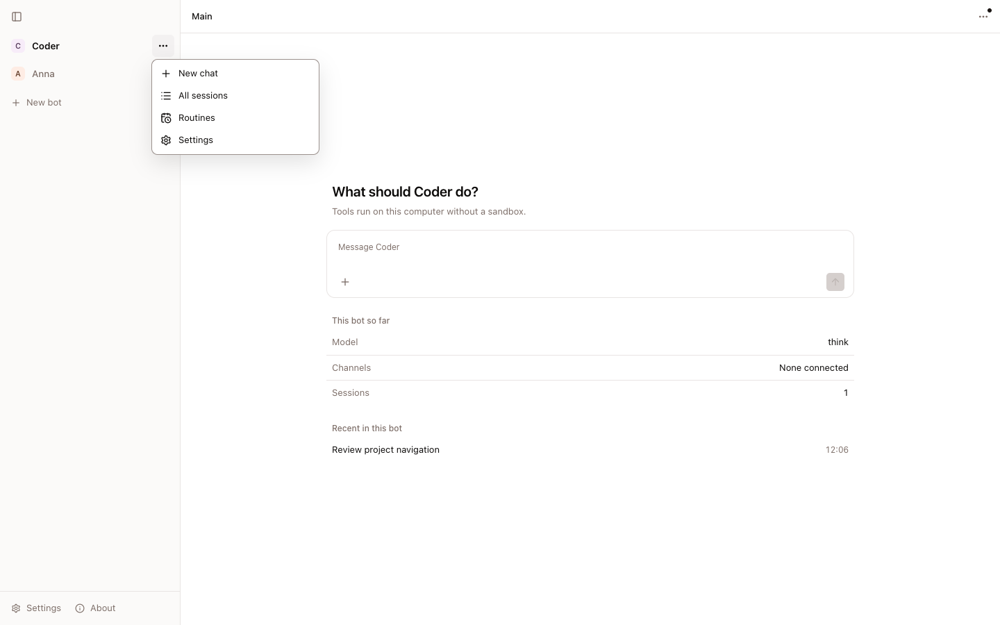
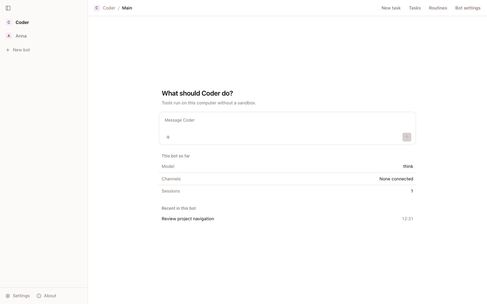
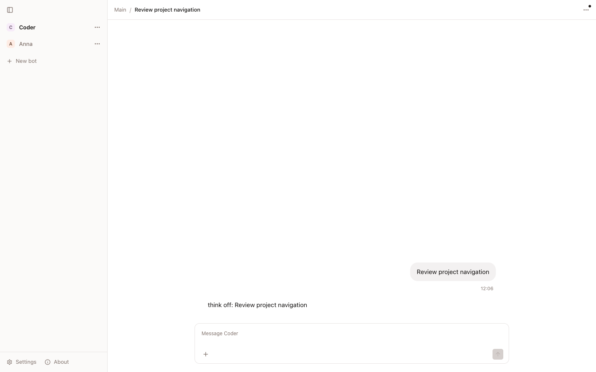
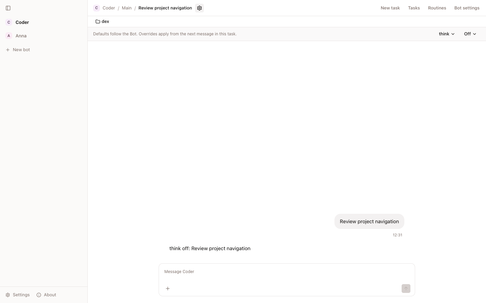
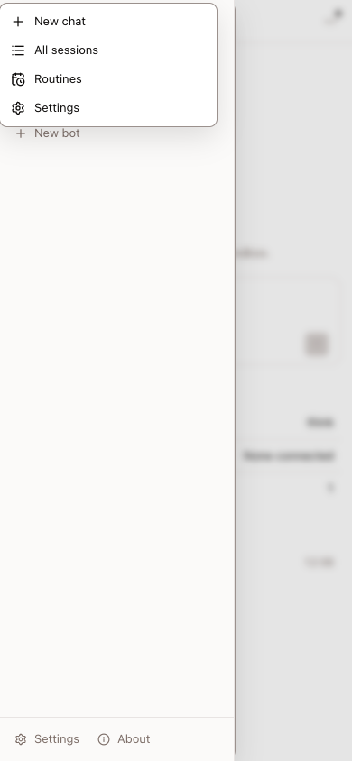
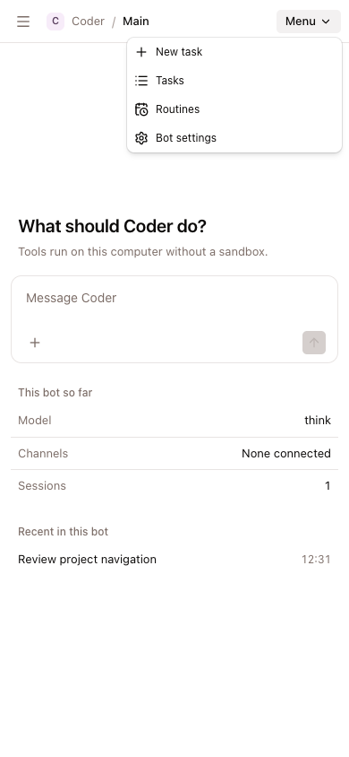
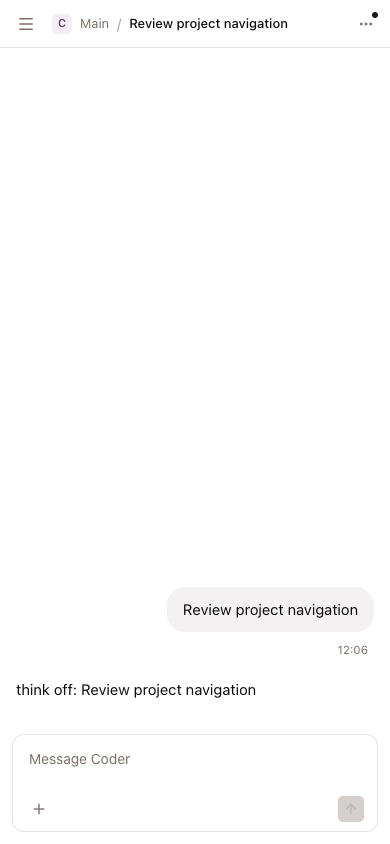
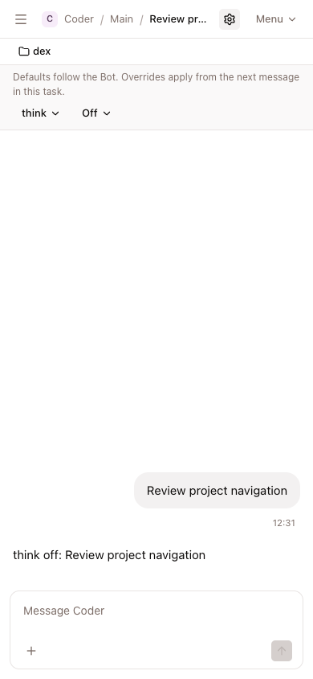

# Bot navigation and task settings

These screenshots use an isolated app, the faux provider, and Chrome. They do
not show production data. Desktop captures use 1440 × 900 pixels. Phone captures
use 390 × 844 pixels.

The before images use `c2c380589de8860159a759cd3892c732e882b6d7`. The after
images use this change. Both use the same bot names and task text. The after
task images show task settings open. The project remains visible when those
settings are closed.

| View               | Before                                                                            | After                                                                      |
| ------------------ | --------------------------------------------------------------------------------- | -------------------------------------------------------------------------- |
| Desktop navigation |          |        |
| Desktop task       |                 |  |
| Phone navigation   |  |       |
| Phone task         |                            |          |

## Repeat the checks

Run `mise run check:navigation-browser .local/navigation-evidence/after`.
The task saves screenshots and `results.json`. It checks project selection,
project inheritance, task settings, and the reset of old Main overrides.
The browser harness is [navigation-browser.mjs](../../../web/tools/navigation-browser.mjs).

To capture a base binary, pass an output directory and `--baseline` to the
same harness. Baseline mode captures the old menus without the new assertions.
